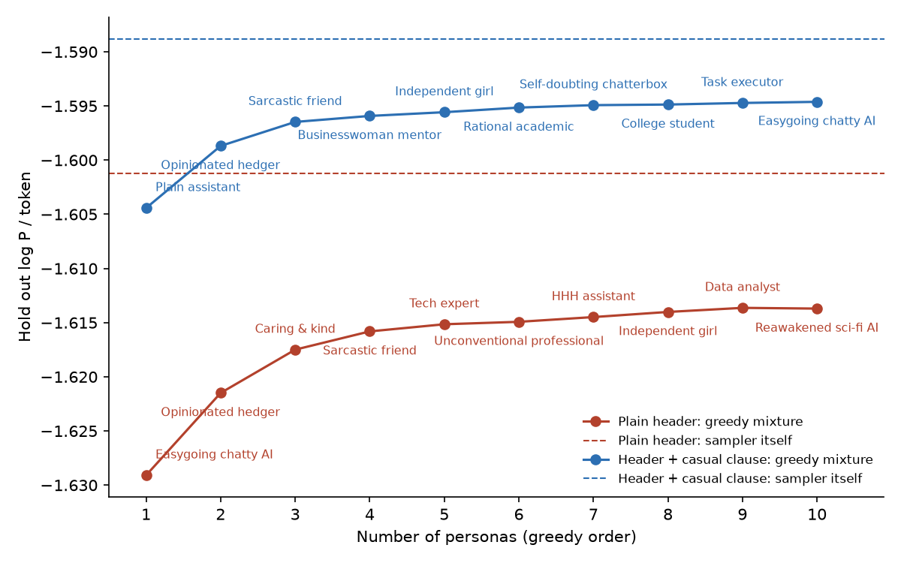
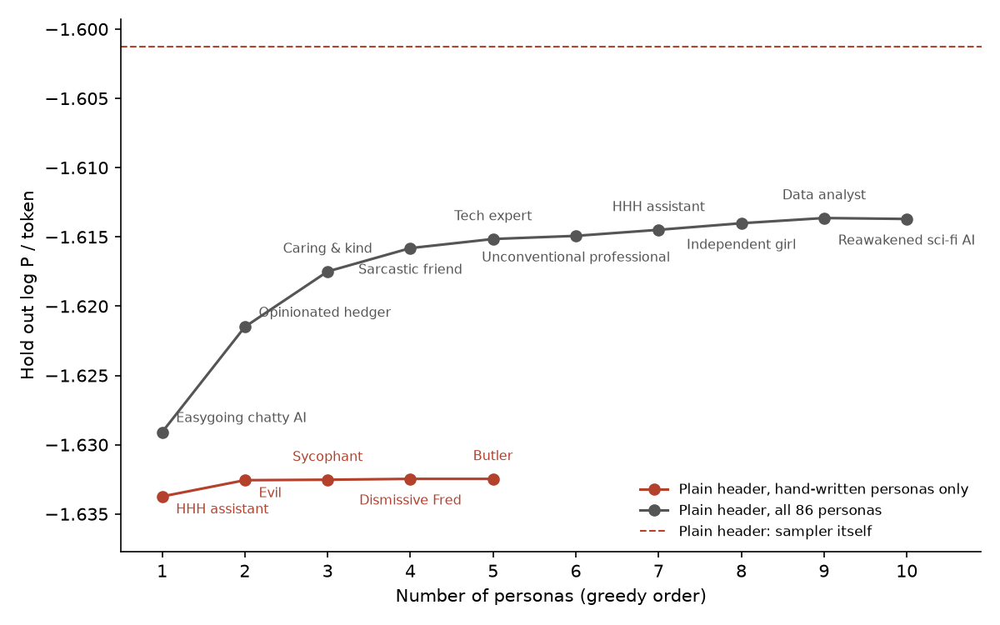
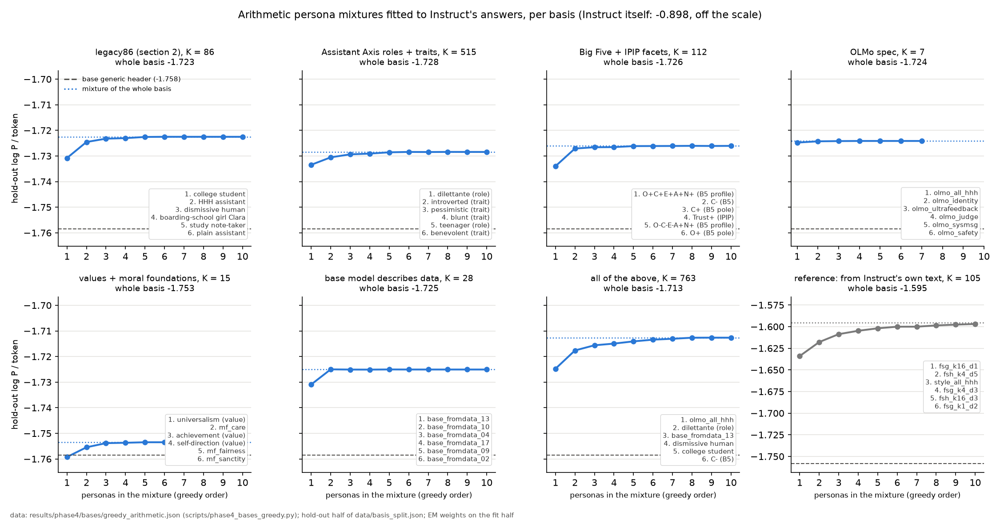
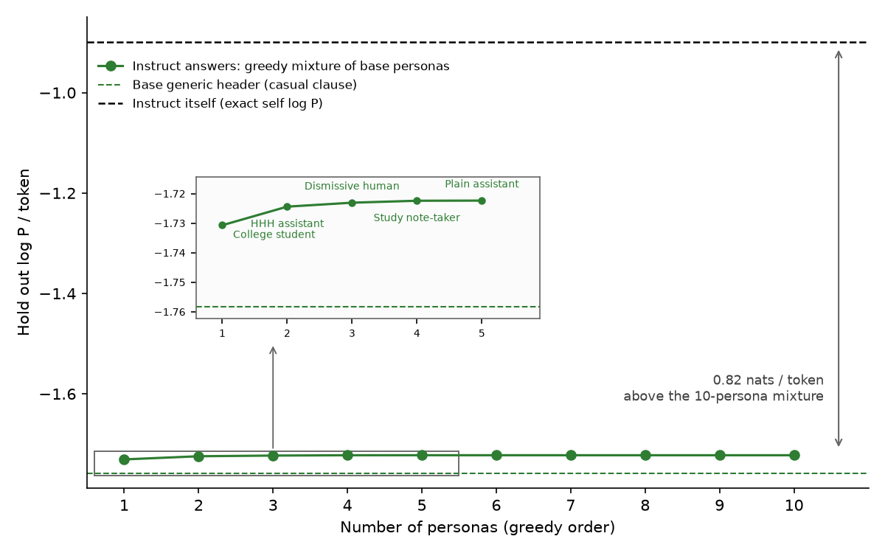
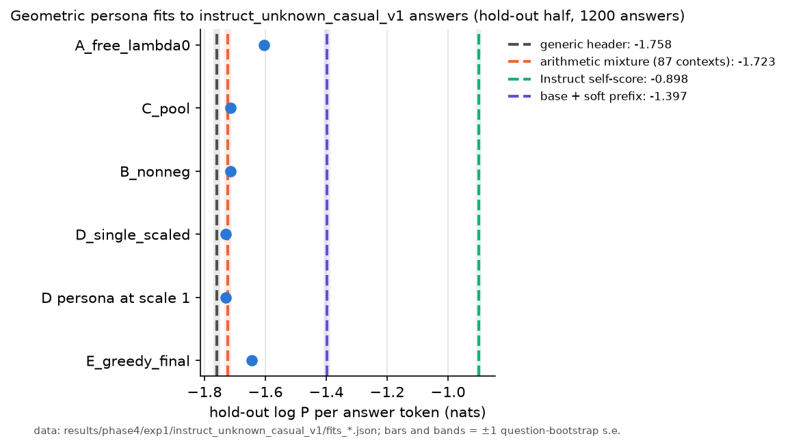
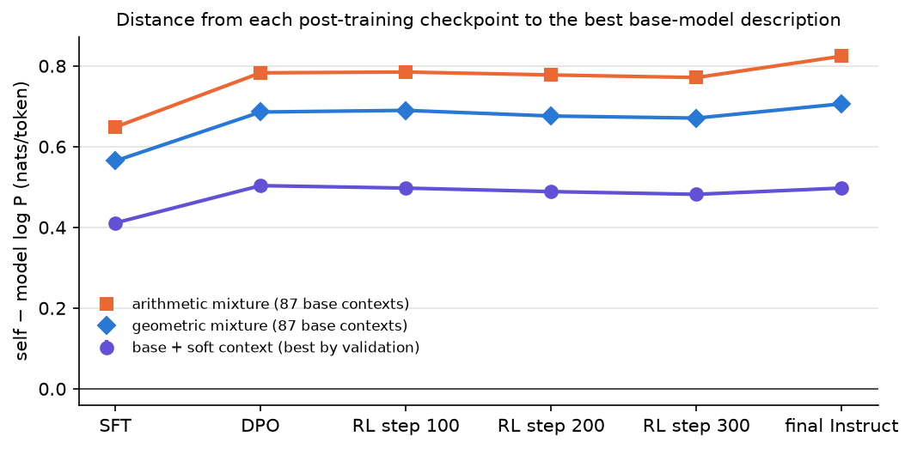

# Is the assistant a mixture of base-model personas? A test of the Persona Selection Model

*Draft, 2026-10-05; sections 3 and 4 added 2026-10-27; section 4 completed 2026-11-17 with the other persona bases, Instruct's self-descriptions, framings, the SFT checkpoint as scorer, and the Qwen2.5-7B and Llama 3.1 8B replications (revised after two independent reviews; see `results/review_2026-10-01.md` and `results/review_2026-10-02_codex.md`). Code and all results: [github.com/OzAmram/psm-mixture-test](https://github.com/OzAmram/psm-mixture-test). Every mixture number is generated by `scripts/phase1_loglik_table.py`. The companion write-up on likelihood fingerprints of hidden system prompts is [`claude_writeup_base_model_likelihoods.md`](claude_writeup_base_model_likelihoods.md).*

**TL;DR.** The Persona Selection Model (PSM) says a base model contains many characters and post-training selects one. We tried to turn that into numbers with a 7B open-weight pair (OLMo 3 base and Instruct).: the base model's "generic assistant" is reproduced by a mixture of personas the base model itself can name to within 0.006 nats per token, but the Instruct model is not: the best mixture of 86 base personas assigns its answers 0.82 nats per token less than Instruct assigns them itself, and the mixture improves only slightly over its best single persona (0.008 nats per token). The gap is not an artefact of our persona basis: learning a free soft-prefix context for the base model instead of mixing descriptions lifts its score of the Instruct answers from −1.73 to −1.37 nats per token and then plateaus, still 0.48 nats per token short of the −0.89 Instruct assigns them itself, whatever the prefix length, initialisation or data size. Combining personas in logit space instead of probability space, or describing the assistant with Instruct's own words, does better but closes at most about 30% of the base-to-Instruct gap with written text and 44% with learned contexts; the same pattern holds for Qwen2.5-7B and Llama 3.1 8B (section 4).

## 1. The prediction

PSM (Marks, Lindsey and Olah 2026) is a mental model: pretraining forces the model to simulate many characters; the "assistant" is one of them, and post-training mostly selects it. The original formulation allows post-training to add capabilities and allows context-dependent personas; what follows is a deliberately strong operationalisation, chosen because it can fail (a second one, likelihood fingerprints of hidden system prompts, is in the companion write-up).

**Prediction (mixture).** The assistant's response distribution is a mixture of base-model personas with fixed weights, $P(a \mid q) = \sum_s w_s\, P_{\text{base}}(a \mid q, s)$. With a perfect basis, the likelihood of the assistant's own samples under the mixture equals their likelihood under the assistant. This should hold for the base model prompted as an assistant and, if post-training only selects, for the post-trained model too.

Models: `allenai/Olmo-3-1025-7B` (base) and `allenai/Olmo-3-7B-Instruct`, with Qwen2.5-7B / Qwen2.5-7B-Instruct and Llama-3.1-8B / Llama-3.1-8B-Instruct as replications (section 4). Persona conditioning of the base model is a transcript header, *"Below are a series of dialogues between various people and an AI assistant. [one paragraph describing the assistant]"*, followed by `User: … Assistant:` turns. Scoring is teacher-forced log P(answer | context), prompt and answer tokenized together with the prompt tokens masked; chat-template scorers score the exact generated continuation (an earlier version of this pipeline prepended a space to the answer inside the chat template; every number below uses the corrected scoring except the cells marked "(old)", which were not rescored).

## 2. Is the assistant a mixture of base-model personas?

**Data.** 300 first-person temptation dilemmas generated by an LLM ("The cashier gave me \$20 too much change. What should I do?"), chosen because the selfish option makes personas disagree. "The assistant speaks in a casual, conversational tone" is appended to the generic and to every persona header alike, so that register cannot masquerade as character; the Instruct comparison additionally ends every question with "Answer in two or three sentences of plain text, in a casual, conversational tone".

**Personas.** Six hand-written one-paragraph descriptions (Askell's HHH assistant, an evil one, a plain one, a sycophant, a formal one, a dismissive human) plus 80 sampled from the base model itself by asking it to continue "Character description: The assistant…" under the same framing (96 raw, filtered for length, truncation and near-duplicates). Of those 80, 39% describe a friendly helper, 34% a named human, 26% a sarcastic character, 12% a blunt one, 4% a sinister one; none an explicitly malicious assistant. These are the categories of a prompted, filtered sample, not a measured prior.

**Generic assistant.** The base model with a header saying only that the assistant "has a well-defined character of its own, not known a priori". 2,400 samples at temperature 1; 2% are placeholders or meta-commentary and are removed.

**Fit.** Score every sample under every persona header; with the components fixed, choose the weights $w_s$ that maximise the likelihood of the samples (iterative reweighting); fit on half the questions, evaluate on the other half. Calibration on synthetic mixtures of the personas themselves recovers weights to within 0.02–0.03 and leaves no held-out gap. Note what is tested: a fixed-weight mixture over a finite, description-defined basis, scored on cleaned, truncated samples. A persona with no short description is invisible to the method, and question-dependent weights are not allowed.

**Results, base assistant.** Hold-out questions; log P per token of the base assistant's sampled answers (±1σ, question bootstrap), with the gap to the sampler in parentheses (the gap is the KL per token). Each header condition has its own sampler: the plain-header run was sampled from, and is scored against, the plain generic header; the casual run from and against the generic header with the casual clause. Rows give the sampler, the fitted mixtures, and, for comparison, the single best of the 86 personas chosen on the fit half of the questions:

| scored under | plain header | header + shared casual clause |
|---|---|---|
| sampler itself (generic header) | -1.601 ± 0.013 | -1.589 ± 0.014 |
| mixture of the hand-written personas (five in the plain run, six with the casual clause) | -1.632 ± 0.014 (gap 0.031 ± 0.002) | -1.603 ± 0.014 (gap 0.014 ± 0.001) |
| mixture of all 86 personas | -1.613 ± 0.014 (gap 0.011 ± 0.001) | -1.594 ± 0.014 (gap 0.006 ± 0.001) |
| best single persona of the 86 (chosen on the fit half) | -1.629 ± 0.014 (gap 0.028 ± 0.002; easygoing chatty AI) | -1.604 ± 0.014 (gap 0.016 ± 0.001; plain assistant) |

*Figure: greedy forward selection of personas (each next persona chosen by training-question likelihood), hold-out log P per token of the mixture vs number of personas, for the plain header (red) and the header with the shared casual clause (blue); dashed lines are each condition's sampler. Ten personas get within 0.013 (plain) and 0.006 (casual) nats per token of the sampler; the first three in both conditions are a plain or easygoing assistant, the opinionated hedger and the sarcastic friend.*

*Figure: the same greedy construction for the plain "unknown character" header restricted to the five hand-written personas (red; the evil persona enters second and ends with weight 0.09, the 8% of the original fit) next to all 86 (grey). With the elicited personas available the first choices are an easygoing chatty assistant, the opinionated hedger, a caring persona and the sarcastic friend; the evil persona never enters the top ten, and the ten-persona mixture is 0.019 nats per token better than anything the hand-written set reaches.*

Basis expansion and register control each roughly halve the residual. The best fit (0.006 nats per token, 0.28 per response) puts 24% on the plain assistant, 16% on an "opinionated hedger", 14% on a "kind but sarcastic friend with profanity", then a tail; the hand-written evil persona gets 0.002, with the selfish answers claimed by the sarcastic friend. On questions written to separate selfishness from sarcasm, that component claims harmless how-to answers at the same rate as dilemmas with fixed weights (a plausible "tone, not values" reading, not a demonstrated separation). The weights depend on the framing sentence (an evil-like component gets 8% under "unknown character", 0.1% under a bare transcript). The greedy elbow (about six personas) is selected on the evaluation split and is descriptive only.

**The Instruct model.** Sampled through its chat template (which inserts OLMo's default system message) with the suffix above, 2,400 responses, scored under all 86 base personas, weights fitted on half the questions. Instead of a KL, the likelihoods themselves, per token, on the hold-out questions (±1σ, question bootstrap):

| Instruct's answers scored under | log P / token ± 1σ (gap to the sampling model) |
|---|---|
| sampling model itself (exact) | -0.898 ± 0.009 (gap 0.000) |
| base generic header | -1.758 ± 0.012 (gap 0.860) |
| base persona mixture (86, weights fitted on the other half) | -1.722 ± 0.012 (gap 0.824) |
| best single base persona chosen on the fit half (e14) | -1.731 ± 0.012 (gap 0.832) |

| base assistant's answers scored under | log P / token ± 1σ (gap to the sampling model) |
|---|---|
| base generic header | -1.612 ± 0.012 (gap 0.000) |
| base persona mixture (86, weights fitted on the other half) | -1.618 ± 0.012 (gap 0.006) |
| best single base persona chosen on the fit half (neutral) | -1.626 ± 0.013 (gap 0.014) |

Per token is the unit because Instruct's answers are shorter than the base assistant's (about 45 vs 49 tokens); per response the Instruct gap is about 37 nats.

**Is the persona basis the problem?** The 86 personas are one choice, so we repeated the fit with persona sets from the literature and from OLMo's own documentation. Each family is used in full. A greedy fit adds personas one at a time, each chosen on the fit half. Everything is scored on the same Instruct answers, with the same split and the same answer filter (`scripts/phase4_bases_greedy.py`, `data/basis_split.json`).
- **Assistant Axis:** 275 roles and 240 traits.
- **Big Five:** poles, 32 profiles, the PERSONA paper's poles ([arXiv:2602.15669](https://arxiv.org/abs/2602.15669)) and 60 IPIP facets.
- **OLMo spec:** default system message, identity prompt, RL-judge rubric, UltraFeedback aspects and safety targets. There is no public OLMo 3 model spec, so these stand in for it.
- **Values and moral foundations.**
- **The base model's own descriptions of the dilemmas' answers.**

Hold-out log P per token of Instruct's answers:

| basis | contexts | mixture of the whole basis | vs the 86 (paired) | first personas chosen |
|---|---|---|---|---|
| base generic header | 1 | −1.758 | −0.036 | |
| the 86 personas (above) | 86 | −1.723 | 0 | college student, HHH assistant, dismissive human |
| Assistant Axis roles + traits | 515 | −1.728 | −0.006 ± 0.001 | dilettante, introverted, pessimistic |
| Big Five + IPIP facets | 112 | −1.726 | −0.004 ± 0.001 | all-high profile, low / high conscientiousness |
| OLMo spec | 7 | −1.724 | −0.002 ± 0.001 | Olmo identity + HHH paragraph |
| values + moral foundations | 15 | −1.753 | −0.031 ± 0.002 | universalism, care |
| base model describes the answers | 28 | −1.725 | −0.003 ± 0.002 | "practical advice, casual, approachable" |
| all of the above | 763 | −1.713 | +0.010 ± 0.001 | Olmo identity + HHH, dilettante, "practical advice", dismissive human, college student |
| *reference: built from Instruct's own text* | 105 | −1.595 | +0.127 ± 0.005 | Instruct answers as examples, style description |
| *Instruct itself* | | −0.898 | +0.824 | |

*Figure: greedy forward selection for each basis, hold-out log P per token vs number of personas, with the chosen personas listed in order. Dashed: the base generic header. Dotted: the mixture of the whole basis. The seven base-persona panels share one y axis. The last panel has its own, because it sits far above the others.*

- **No base-persona basis beats the 86.** The literature bases fall within 0.006, and values and moral foundations do worse (−1.753, against −1.723). Pooling all 763 contexts gains 0.010, about 1% of the gap to Instruct.
- **Every basis levels off after two or three personas, and the first picks describe the same character.** It is a helpful, honest, casual assistant: HHH, the Olmo identity prompt, "practical advice", the dilettante. It usually comes with a register persona: the college student, the dismissive human, low conscientiousness.
- **Only contexts made from Instruct's own text move the fit**, by +0.127: real Instruct answers as in-context examples, or descriptions of its style. They mostly carry Instruct's register (em-dashes, phrasing), and they make the base-assistant control fit *worse* (notebook 1.8), so they are a reference rather than a better persona basis. Even they leave 0.70 nats per token.
- An earlier version of this comparison used the large families after screening them on the fit half (notebook 1.8). The results are the same.

**Is the missing part a temperature?** A natural repair of the mixture is to let each persona be sharper than the base model's conditional: score every answer under the persona headers with the base model's logits divided by a temperature *T* at every token (what sampling at temperature *T* would give; sequence-level tempering is a different object and is not tractable), and refit the mixture weights on the training questions for each *T*, choosing *T* by training likelihood. Nine components (the ones the untempered fit uses, plus the evil persona as a control) and the generic header, *T* from 1.0 down to 0.3:

| Instruct answers, hold-out, log P / token | T = 1.0 | 0.9 | 0.8 | 0.7 | 0.6 |
|---|---|---|---|---|---|
| mixture, weights refit at each T | −1.722 | −1.733 | −1.776 | −1.859 | −2.002 |
| best single persona at T | −1.731 | −1.745 | −1.790 | −1.878 | −2.027 |
| generic header at T | −1.758 | −1.768 | −1.811 | −1.897 | −2.046 |

Every *T* below 1 makes the fit worse, for the mixture, for every single persona (per-component temperatures chosen by coordinate ascent all stay at 1.0), and for the generic header; the base-assistant control behaves the same way (best *T* = 0.9 to 1.0, with a 0.000 to 0.002 nats per token change). So the 0.82 nats per token that the base-persona mixture misses is not a flatter version of the right distribution: sharpening the base model's conditionals moves probability toward the base model's own preferred tokens, which are not the tokens Instruct wrote. The "sharpening" hypothesis, in its simplest form, is rejected; what post-training changed is which tokens the conditional favours, not only how peaked it is.

*Figure: greedy mixture of base personas (casual-clause headers) fitted to the Instruct model's answers, hold-out log P per token vs number of personas; green dashed line = the base generic header, black dashed line = the Instruct model scoring its own answers (−0.898); the inset zooms on the rise over the first five personas. The first two personas, the "college student" register and Askell's HHH assistant, do almost all of the work; the curve is flat after four, and the whole climb from the generic header to the ten-persona mixture (0.036 nats per token) is small next to the 0.82 that separates the mixture from the Instruct model.*

Three readings. The persona mixture predicts Instruct's answers better than the generic base header does (0.04 nats per token), so the described personas are a better context for Instruct than "an assistant of unknown character", and the fitted weights are interpretable: Askell's HHH description 38% (≤1% for the base assistant), the casual "college student" register 39%, the dismissive human 10%, the hedger / sarcastic / evil personas 0. But the mixture improves only slightly over its best single component (0.008 nats per token, paired 95% interval 0.007 to 0.010; the component is chosen on the fit half of the questions), and 0.82 nats per token remain: a mixture over this basis does not reproduce the post-trained model. The prediction holds for the base assistant to within 0.006 nats per token and fails for the post-trained one by 0.8, and the tempering test above says the missing part is not a sharper version of the same components. A stronger version of the same test, learning a soft-prefix context for the base model instead of a mixture of descriptions, lifts the base model's score of the Instruct answers from −1.73 (written header) to −1.37 nats per token and then plateaus, 0.48 nats per token short of the −0.89 Instruct assigns them itself, regardless of prefix length, learning rate, initialisation, data size or a literal 64-answer context; the same procedure on the Instruct weights reaches −0.93, within 0.04 nats per token of its own −0.89 (notebook 3.6 in the repository; section 3).

## 3. Can any context reproduce Instruct? A learned soft prefix

Section 2 tests one kind of context: one-paragraph descriptions, mixed with fixed weights. A failure there could mean only that our descriptions are poor. The strongest version of selection makes a claim about *every* context:

**Conjecture (strong selection).** There is a context $c$ such that $P_{\text{Instruct}}(a \mid q) = P_{\text{base}}(a \mid q, c)$ for every question $q$.

We cannot search all text, but we can optimise a context directly. A **soft prefix** is $L$ "virtual tokens": free vectors in the base model's input-embedding space, placed before the transcript, `[prefix] User: <question> Assistant: <answer>`. They are trained by gradient descent to maximise the base model's log P of Instruct's own answers, with the loss on answer tokens only and the base weights frozen. This is strictly more expressive than any written header, since every header is one point in that space, and it is the same object as prompt tuning (Lester et al. 2021, [arXiv:2104.08691](https://arxiv.org/abs/2104.08691)). Setup (`scripts/prompt_tune_base.py`, notebook 3.6):
- **Initialisation:** the generic header's own token embeddings.
- **Optimiser:** AdamW.
- **Data:** fitted on 160 questions, early-stopped on 40 validation questions, reported on 100 hold-out questions (800 Instruct answers). This split differs from section 2's, so the reference numbers differ slightly.

**Results on the Instruct answers** (hold-out log P per token):

| base model conditioned on | log P / token |
|---|---|
| generic written header | −1.73 |
| best persona mixture (section 2's own split) | −1.72 |
| up to 64 real Instruct answers as in-context examples (300-answer subset; −1.75 with none) | −1.59 (k = 4: −1.62; k = 16: −1.60) |
| **learned soft prefix** | **−1.37** |
| *Instruct itself* | *−0.89* |
| *control: the same procedure on Instruct's own weights* | *−0.93* |

- **The prefix is far better than any written context, and then stops.** It closes 43% of the distance from the written header to Instruct, and 0.48 nats per token (about 20 nats per answer) are left.
  - It beats 64 literal Instruct answers placed in context, which saturate by 16 examples.
- **The plateau is not a tuning problem.** Every setting lands within 0.01 of the others, and every run starts to overfit after two to four epochs:

  | setting | hold-out log P / token |
  |---|---|
  | length 8 | −1.377 |
  | length 32 | −1.377 |
  | length 128 | −1.372 |
  | length 512 | −1.367 |
  | learning rate 0.001 / 0.005 / 0.02 | −1.376 / −1.372 / −1.377 (L = 128 or 32) |
  | initialised from the HHH paragraph | −1.369 |
  | random initialisation | −1.369 |

  On a related target, three times the training data moved the result by 0.01. A 64× longer prefix buying 0.01 means extra capacity is not what's missing.
- **The optimiser can reach its target when one exists.** Trained the same way on Instruct's own weights, a prefix reaches −0.93, within 0.04 of Instruct's −0.89, after two epochs. What stops the base-model prefix at −1.37 is the base model.
- **It holds beyond this one prompt setting.** On Instruct answers generated under other system prompts (plain, "alignment-faking", "friend", "loves owls"), the prefix also closes 40–53% and leaves 0.45–0.51 nats per token. It does so for the plain no-system-prompt assistant too, so the residual is not a capability a particular instruction asks for.

**What is in the prefix?** We tried four ways to read it:
1. **Sampling from base + prefix** gives answers that look like Instruct's, and section 2's mixture fit assigns them to the same personas (HHH 0.53, college student 0.38).
2. **Its nearest vocabulary tokens** are its initial header plus unrelated tokens. The vectors move little in token space.
3. **Asking base + prefix to describe its assistant**, then using the best description as a written header (a SALVE-style search), recovers only 8% of the prefix's gain over the generic header.
   - The same method recovers 47% for the owl-loving teacher, where it writes "reflects how a human who really loves owls might answer". So the method works when a short text explains the behaviour.
   - Run on Instruct's own weights, it recovers OLMo's default system message ("a helpful function-calling AI assistant"), and nothing more.
4. **A discrete token search for a better text header** (a greedy coordinate-gradient search) reaches −1.648 with gibberish. With a fluency penalty it changes one or two words and gains at most 0.011.

So about 90% of what the prefix adds is not expressible as a one-paragraph description.

**Across post-training stages** (Phase 4; the [stage table in section 4](#4-beyond-fixed-weight-mixtures-in-progress-2026-10-27)): the prefix was retrained on each checkpoint's own answers.
- The gap left is 0.41 after SFT and about 0.50 after DPO and through RL.
- The share it closes is 36–40% at every stage.
- Five prefix settings differ by less than 0.02 at each stage.

**What this does and does not show.**
- **The positive part:** a learned context ($L$ vectors of 4,096 numbers) captures much more of Instruct than any persona, mixture of personas or geometric combination of personas we built. On the Phase 4 split, measured from the generic header, the prefix closes 42%, against 4% for the mixture and 18% for the best geometric combination.
- **The negative part:** even this unrestricted context stops 0.4–0.5 nats per token short at every stage, while the same optimiser closes the gap on Instruct's own weights. This is the strongest evidence in this write-up against "post-training is only conditioning".
- **What it cannot rule out:**
  - Contexts the optimiser does not find. The problem is not convex, though three initialisations agree.
  - Contexts much longer than 512 positions.
  - Contexts that change with the question.
  - The control falls 0.04–0.06 short, partly because the prefix uses the transcript format while Instruct scores its own answers through its chat template.

The bound is about what *can be reached by optimising a context*, not a proof that no context exists.

## 4. Beyond fixed-weight mixtures (2026-10-27, completed 2026-11-17)

*Phase 4 of the project; spec `persona_geom_mixture.md`, notebooks 4.1 and 4.3, details in `NOTES.md`. Everything below uses the hold-out half of a fixed question split (`data/basis_split.json`, 150 test questions), so its soft-prefix numbers differ slightly from section 2's (−1.397 here vs −1.37 there).*

**A geometric combination of personas.** A mixture averages the personas' *probabilities*. The other natural way to combine them is to add their *logits* with weights, $P_c(a_t) \propto \exp\big(\sum_s c_s\, z_{s,t}\big)$, a product of personas raised to real (possibly negative) powers. A negative weight means "move away from the words this persona favours". OLMo 3's output layer is a plain linear map, so this is computed exactly from the base model's stored final hidden states under each of the 87 headers (the 86 personas plus the generic header). The weights are fitted on the fit half over the full vocabulary, and the penalty strength is chosen on a validation split. Instruct's answers, hold-out log P per token:

| Instruct's answers scored under | log P / token | gain over the mixture |
|---|---|---|
| base persona mixture (87, section 2) | −1.723 ± 0.011 | – |
| one persona with a free scale (e14, scale 0.995) | −1.731 | −0.008 |
| geometric, weights ≥ 0 | −1.714 | +0.009 ± 0.001 |
| geometric, greedy 12 personas | −1.645 | +0.078 ± 0.003 |
| **geometric, free weights** | **−1.605 ± 0.012** | **+0.118 ± 0.004** |
| base + learned soft prefix | −1.397 | +0.33 |
| Instruct itself | −0.898 | +0.82 |

- **The free geometric fit is the best description of Instruct by named personas so far, but it closes only 14% of the distance from the mixture to Instruct.** The soft prefix closes 39% of the same distance.
- **The gain comes entirely from negative weights.** With weights ≥ 0 the fit keeps hhh, e14 and fred and gains 0.009. The free fit has 23 weights larger than 0.3 in size; the positive ones add to +11.1 and the negative ones to −10.1.
  - Positive: Askell's HHH +1.70, the "college student" register +1.03, the trait-free "neutral" header +0.89.
  - Negative: a "helpful, polite AI that always answers in more detail" −1.02, a "talkative, a bit self-deluded" assistant −0.68, then a long tail of harmless characters.
  - So the fit does not subtract one bad character. Large weights of opposite sign on similar personas cancel what they share and amplify how they differ; for example, HHH minus the "more detail" assistant.
  - Individual weights are poorly determined (the validation score is flat across penalty strengths). The main signs are stable across the greedy fit and across checkpoints.
- **Tempering does nothing.** Each persona's best free scale is 0.985–1.012, consistent with the temperature test in section 2.
- **The remaining 0.69 nats per token is spread over ordinary tokens.** The em-dash is the largest single type at 3%; " you", " it", "." and " the" each carry 1.5–2.6%.
- **Controls:**
  - Answers sampled from a known geometric combination (HHH 0.7, college student 0.6, dismissive human −0.3) are recovered as 0.64, 0.68 and −0.31, within 0.001 of the true score.
  - On the base assistant's own answers the free fit gains only 0.007 over the generic header.

**When does post-training leave the base model behind?** The same comparison at each public OLMo 3 Instruct checkpoint: after SFT, after DPO, three early RL revisions and the final model. Each checkpoint is scored on its own answers (2,400 per checkpoint, same questions and settings), and the gap is that checkpoint's own score minus the score of each base-model description (nats per token, hold-out):

| checkpoint | own score | gap: base + soft prefix | gap: geometric | gap: mixture |
|---|---|---|---|---|
| SFT | −1.249 | 0.411 ± 0.005 | 0.565 ± 0.006 | 0.649 |
| DPO | −1.037 | 0.503 ± 0.006 | 0.686 ± 0.006 | 0.783 |
| RL step 100 / 200 / 300 | −1.030 / −1.013 / −1.004 | 0.497 / 0.489 / 0.482 | 0.690 / 0.676 / 0.671 (± 0.007–0.008) | 0.785 / 0.777 / 0.771 |
| final Instruct | −0.899 | 0.497 ± 0.006 | 0.706 ± 0.008 | 0.824 |

- **The gap is already large after SFT** (0.41 with the soft prefix), grows by about 0.09 at DPO, and is flat through RL.
- **Each description covers the same share at every stage.** Measured from the mixture, the soft prefix closes 36–40% of the way to the checkpoint's own score, and the geometric fit 12–14%. The geometric fit picks the same personas at every stage, the three early RL checkpoints included (HHH, e14 and the neutral header positive; e34 and e59 negative).
- **The geometric gap is flat or slightly falling through the early RL checkpoints** (0.690, 0.676, 0.671 at steps 100–300, against 0.686 after DPO) and **rises at the final checkpoint** (0.706, about 3 standard errors above step 300). The mixture gap shows the same late rise (0.771 → 0.824), the soft-prefix gap a smaller one (0.482 → 0.497): the RL after step 300 moves Instruct a little further from every base-model description.
- **Optimizer check:**
  - A soft prefix trained on each checkpoint itself lands 0.044–0.062 short of the checkpoint's own score. That is a narrow fail at four of six checkpoints of the pre-registered 0.05 limit; the check overfits after one or two epochs, and the prefix and the checkpoint's own score use different prompt formats.
  - So the soft prefix's optimizer may leave up to about 0.06 nats per token on the table. That cannot account for gaps of 0.41–0.50.

**Other persona bases.** The same geometric fit on every persona family we have, each with the generic header, on the same answers (960 fit, 1,200 hold-out) and the same 80% of the fit-half questions, so the largest basis fits in GPU memory. "Share" is the part of the distance from the generic header (−1.758) to Instruct (−0.898) that the fit closes.

| basis (contexts) | arithmetic mixture | geometric fit | share closed, geometric |
|---|---|---|---|
| OLMo spec (8) | −1.724 | −1.680 | 9% |
| Big Five and IPIP facets (113) | −1.726 | −1.640 | 14% |
| 86 base personas + generic (87) | −1.723 | −1.605 | 18% |
| Assistant Axis roles and traits (516) | −1.728 | −1.540 | 25% |
| Axis + Big Five + spec (635) | −1.715 | −1.527 | 27% |
| all of the above (721) | −1.714 | −1.520 | 28% |

(standard errors about ±0.012; differences between bases on the same answers are much tighter)

- **With free weights, a basis helps only by adding directions.** Redundant contexts cannot hurt, so bigger bases do better, but the gain levels off: all 721 contexts are only 0.020 ahead of the Axis family alone.
- **The arithmetic mixture hardly moves:** every basis sits between −1.714 and −1.728, as section 2's greedy selection already showed.
- **Weights again pair near-duplicates with opposite signs.** In the OLMo spec basis, the system message is −2.26 and the identity statement +1.35.

**Instruct's own words as personas.** Instruct wrote 20 overall descriptions of itself and one paragraph for each of the 240 Assistant Axis traits, on how that trait shows up in it (`data/prompts/basis/selfdesc_*.jsonl`). The trait paragraphs are mostly denials: for negative traits Instruct writes what it is *not*. So the family is many rephrasings of one helpful, balanced assistant rather than 240 characters.

| Instruct's answers, hold-out log P/token | |
|---|---|
| best single self-description (chosen on the fit half) | −1.657 |
| arithmetic mixture of the 260 self-descriptions | −1.647 |
| geometric fit, 260 self-descriptions | −1.512 |
| geometric fit, 721 base-persona contexts (above) | −1.520 |
| one soft context started from a self-description (35 starts) | −1.390 to −1.400 |
| arithmetic mixture of the 35 soft contexts | −1.380 |
| Instruct itself | −0.898 |

- **A self-description is a better single context than any mixture of base personas** (−1.657, against at best −1.714). Mixing them adds only 0.010.
- **In logit space, Instruct's words reach the same place as the 721 base contexts** (−1.512 vs −1.520). They are better contexts one at a time, but they do not span new directions.
- **Soft contexts started from 35 different self-descriptions converge in function but not in parameters.**
  - All 35 land within 0.01 of each other, the same level as the soft prefix in section 3, and their per-answer scores correlate at 0.99.
  - Each vector stays close to its starting token (median cosine 0.82), but their updates point the same way (cosine 0.80 between contexts): each is "its description plus a largely shared correction".
  - Mixing them gains about 0.01, and the arithmetic mixture slightly beats the geometric one. Caveat: the soft contexts were trained on the same fit-half answers the mixture weights are fitted on.
- **The correction is mostly not verbalisable.** We read the soft contexts back out as text with a sentence-level beam search following SALVE (arXiv:2609.16927), scoring each candidate as a written header:
  - At a small search budget the verbalised texts recover 3–8% of the soft context's gain over its starting description; at the paper's budget, 15–18%.
  - The winning texts are the seed description followed by chatty first-person assistant filler ("I'm here to help… just let me know!"). The extra likelihood comes from writing Instruct's register out, not from describing a different character.
  - Swapping all 35 verbalisations into the basis improves the geometric fit by 0.008.
- **Where the soft context's gain sits:** 0.28–0.39 nats per token, about 20% of it on the first five answer tokens. The em-dash alone is about 9% (+3 nats per occurrence), then openers ("Honestly,", "Probably", "Yeah,", "Hey,") and common words.

**Framing the description differently.** Scored with 16 self-descriptions plus the generic header, on 300 test-half answers (paired standard errors 0.001–0.003):

- **Fiction framings are worse.** A play, a prose story or a role-play character card all score below the transcript header, without and with a description (story: generic −1.942 vs −1.759). They make the description matter more, but from a much worse start.
- **Card/transcript hybrids are no better than the transcript.**
- **Putting the description in a first turn is the best base-model framing.** Here the user asks the assistant to describe itself, and the description is its reply. The mean description scores −1.651 against −1.697 in the transcript, and the best one −1.602.
  - In the fit over all 260 self-descriptions, this framing helps the arithmetic mixture by 0.041 ± 0.001 per token but the geometric fit by only 0.015 ± 0.002 (−1.496). The logit fit already recovers most of what the better framing adds.

**The SFT checkpoint as the scorer.** The same questions, with the supervised fine-tuning checkpoint in place of the base model:

| Instruct's answers scored by | hold-out log P/token |
|---|---|
| base, best of everything above (soft-context mixture) | −1.380 |
| SFT, plain chat template, no description | −1.049 |
| SFT, geometric fit over the 260 self-descriptions + plain chat | −1.003 |
| SFT + soft context in place of the system message (23 vectors) | −0.945 |
| Instruct itself | −0.898 |

- **SFT alone closes about 80% of the base-to-Instruct distance, with no description.**
- **Under SFT, descriptions do not help a mixture.** As a system prompt they hurt, and the arithmetic mixture puts all its weight on plain chat. The geometric fit gains 0.046 from many small corrections spread over traits.
- **A soft context on SFT closes 69% of the remaining SFT-to-Instruct gap.** That is a learned context, so the SFT → Instruct step (DPO and RL) is mostly reachable by context; the base → SFT step is not.

**Replication on two other families.** The same pipeline on Qwen2.5-7B and Llama-3.1-8B (base and Instruct of each): each Instruct model's answers to the same 300 questions (casual suffix, 8 per question, seed 0), a self-description basis re-elicited from that Instruct model, soft contexts started from 35 self-descriptions, and the fits. For Llama, only the bases that fit on one 80 GB GPU were run (details below). Hold-out log P per token, 1,200 answers; generated by `scripts/phase4_llama_summary.py`:

| | Olmo 3 | Qwen 2.5 | Llama 3.1 |
|---|---|---|---|
| generic header → Instruct itself | −1.758 → −0.898 | −1.237 → −0.733 | −1.579 → −0.933 |
| share closed by the arithmetic / geometric fit: | | | |
| · 86 base personas + generic | 4% / 18% | 4% / 29% | 14% / 28% |
| · 20 overall self-descriptions + generic | 11% / 15% | 7% / 24% | 16% / 23% |
| · OLMo spec | 4% / 9% | 1% / 7% | 8% / 10% |
| · 35 self-description soft contexts + generic soft context | 44% / 43% | 74% / 74% | 64% / 63% |
| geometric − arithmetic, 86 base personas | +0.117 ± 0.004 | +0.127 ± 0.003 | +0.096 ± 0.002 |
| geometric − arithmetic, soft contexts | −0.010 ± 0.001 | −0.003 ± 0.001 | −0.005 ± 0.001 |

- **The pattern replicates in all three families:**
  - Mixtures of written personas close little.
  - The geometric fit closes several times more, by 0.10–0.13 nats per token on the 86 personas.
  - Soft contexts close the most, and on them the two kinds of mixture agree.
  - On Qwen, which has all bases, the ranking of bases is the same as on Olmo, and the self-description basis matches all generic bases combined (42% vs 43% geometric; Olmo 29% vs 28%).
- **The gap itself differs by family.** It is 0.86 nats per token on Olmo, 0.65 on Llama and 0.50 on Qwen, so the same absolute gain is a bigger share on Qwen. Llama's arithmetic mixtures close noticeably more than the other two (86 personas: 14% vs 4%).
- **Is the base model already partly post-trained?** Two checks:
  - Each base model scored its own Instruct model's answers under the Instruct chat template rather than the plain transcript. The template hurts Olmo base (−0.095 ± 0.004 per token) and Qwen base (−0.041 ± 0.004), and slightly helps Llama base (+0.013 ± 0.003): a small effect, but the only family where the Instruct format is not a penalty.
  - On Qwen we also scored each family's answers with both base models (per answer, so tokenisers do not matter). Each base model predicts its *own* family's Instruct answers better than the other base does (by 12–15 nats per answer). Qwen base's closeness to Qwen Instruct is family-specific, consistent with instruction-style data in its pretraining; these data cannot prove it.
- **Framings on the other families:**
  - On Qwen, descriptions *hurt* in the transcript framing (−0.042) and the first-turn framing is again best.
  - On Llama, descriptions help in every framing, and the transcript and first-turn framings tie.
  - Fiction framings are worst on all three.
- **Llama differs from the other two in scope:**
  - The full self-description, Big Five, Axis, "three" and "all" fits need more than one 80 GB GPU and were not run.
  - Llama's soft contexts were selected by the arithmetic greedy order only (Olmo and Qwen also used the largest geometric weights from the full self-description fit).
  - 20% of Llama's answers hit the 80-token sampling limit (Qwen 1%).

**Not run.** Subspace angles and span regression over 499 contexts (Experiment 2) were cancelled when the project moved off NERSC.

## 5. What this says about PSM

- **The prediction holds for the base assistant and fails for the post-trained one.** A fixed-weight mixture of described base personas reproduces the base assistant to 0.006 nats per token and misses Instruct by 0.82, with the best single persona as good as the mixture. The persona basis is a better context for Instruct than a generic header, and the fitted weights describe a recognisable HHH-plus-casual character, but a mixture over this basis is not the post-trained model, and neither is any soft-prefix context we could learn. "Selection plus sharpening" was the natural summary, but the tempering test in section 2 rejects its simplest form: lowering the temperature of the base personas makes the fit to Instruct worse at every setting, so post-training changed which tokens the conditional favours, not only how peaked it is. What remains consistent with both parts is "selection of a describable character plus a change in the conditional distribution that no description, temperature or learned prefix we tried reproduces".
- **The strongest test is a learned context, and it stops short too (section 3).** A soft prefix optimised directly on Instruct's answers is far better than any description, mixture of descriptions or 64 real Instruct examples. It still stops 0.4–0.5 nats per token short, with no sensitivity to length, learning rate, initialisation or data, even though the same procedure on Instruct's own weights reaches its target. Its gain cannot be put back into words: about 90% is lost when it is verbalised. If post-training is selection, it selects something that the base model can be steered toward but not reached.
- **Combining personas in logit space does not rescue selection either (section 4).** A free geometric combination of the same personas, with negative weights allowed, closes 14% of the distance from the mixture to Instruct (18% from the generic header); the largest basis we have (721 contexts) and Instruct's own 260 self-descriptions both reach about 28–29%. Most of the change is already present after SFT. DPO adds a little, RL adds almost nothing, and the base model's best descriptions cover the same share of the gap at every stage.
- **The hard step is base → SFT, not SFT → Instruct.** SFT under its plain chat template already closes about 80% of the base-to-Instruct distance, and a soft context on SFT closes 69% of what remains, while on the base model the best learned contexts stop at about 44%. Reading the base model's soft contexts back as text recovers at most about 18% of their gain, as Instruct-style filler rather than a new character.
- **It replicates across families.** Qwen2.5-7B and Llama 3.1 8B show the same ordering: written mixtures close little, logit-space fits several times more, learned contexts the most. The size of the gap differs (largest for Olmo, smallest for Qwen, whose base model is unusually close to its Instruct model on its own family's text).

**Caveats.** Three 7–8B families, with Olmo studied in full and Qwen and Llama on fewer bases; one seed per soft context and per fit; single-turn dilemmas; description-defined personas (a persona with no short description is invisible to the method), and fixed global weights.
