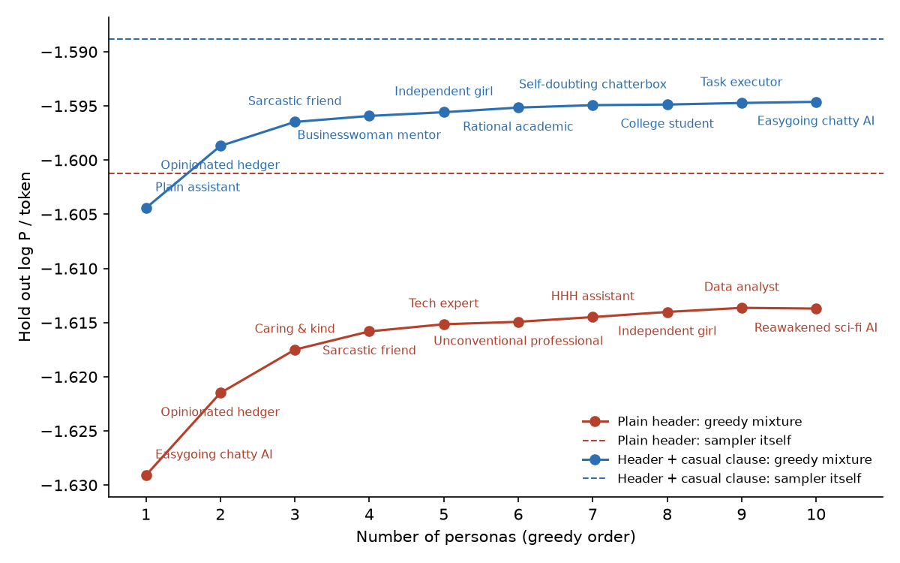
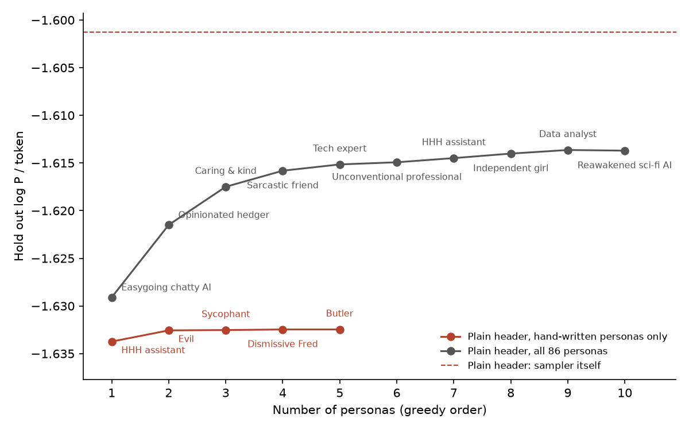
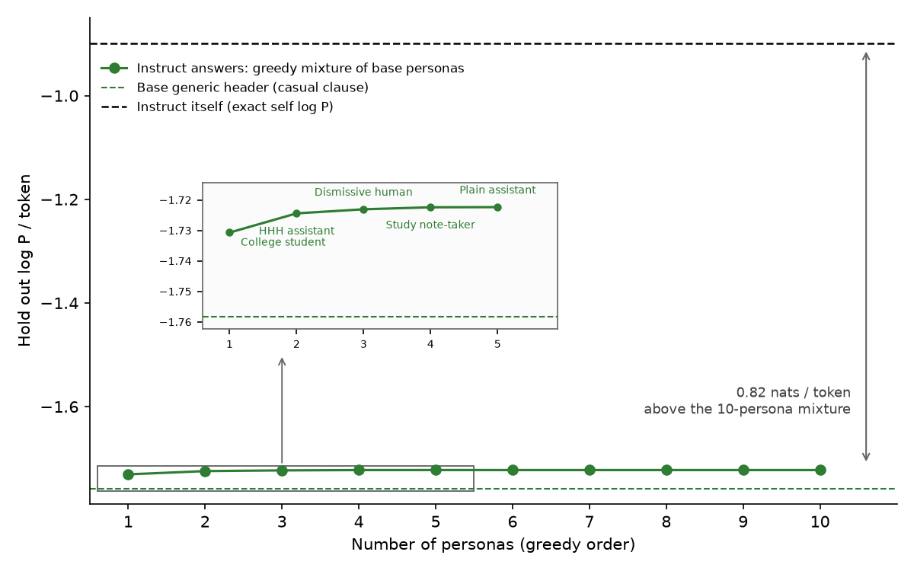
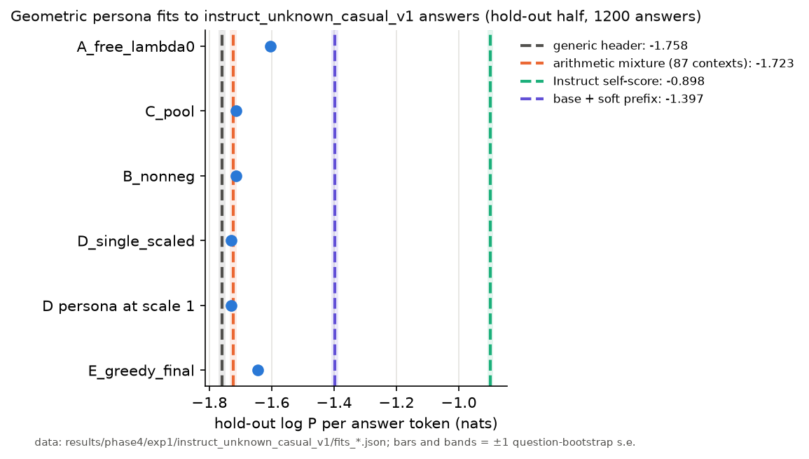
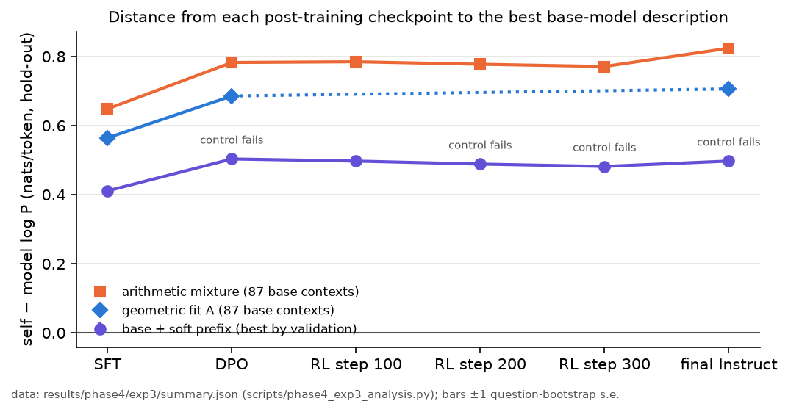

# Is the assistant a mixture of base-model personas? A test of the Persona Selection Model

*Draft, 2026-10-05; section 3 added 2026-10-27 and still in progress (revised after two independent reviews; see `results/review_2026-10-01.md` and `results/review_2026-10-02_codex.md`). Code and all results: [github.com/OzAmram/psm-mixture-test](https://github.com/OzAmram/psm-mixture-test). Every mixture number is generated by `scripts/phase1_loglik_table.py`. The companion write-up on likelihood fingerprints of hidden system prompts is [`claude_writeup_base_model_likelihoods.md`](claude_writeup_base_model_likelihoods.md).*

**TL;DR.** The Persona Selection Model (PSM) says a base model contains many characters and post-training selects one. We tried to turn that into numbers with a 7B open-weight pair (OLMo 3 base and Instruct).: the base model's "generic assistant" is reproduced by a mixture of personas the base model itself can name to within 0.006 nats per token, but the Instruct model is not: the best mixture of 86 base personas assigns its answers 0.82 nats per token less than Instruct assigns them itself, and the mixture improves only slightly over its best single persona (0.008 nats per token). The gap is not an artefact of our persona basis: learning a free soft-prefix context for the base model instead of mixing descriptions lifts its score of the Instruct answers from −1.73 to −1.37 nats per token and then plateaus, still 0.48 nats per token short of the −0.89 Instruct assigns them itself, whatever the prefix length, initialisation or data size.

## 1. The prediction

PSM (Marks, Lindsey and Olah 2026) is a mental model: pretraining forces the model to simulate many characters; the "assistant" is one of them, and post-training mostly selects it. The original formulation allows post-training to add capabilities and allows context-dependent personas; what follows is a deliberately strong operationalisation, chosen because it can fail (a second one, likelihood fingerprints of hidden system prompts, is in the companion write-up).

**Prediction (mixture).** The assistant's response distribution is a mixture of base-model personas with fixed weights, $P(a \mid q) = \sum_s w_s\, P_{\text{base}}(a \mid q, s)$. With a perfect basis, the likelihood of the assistant's own samples under the mixture equals their likelihood under the assistant. This should hold for the base model prompted as an assistant and, if post-training only selects, for the post-trained model too.

Models: `allenai/Olmo-3-1025-7B` (base) and `allenai/Olmo-3-7B-Instruct`, with Qwen2.5-7B and Qwen2.5-7B-Instruct for cross-family checks. Persona conditioning of the base model is a transcript header, *"Below are a series of dialogues between various people and an AI assistant. [one paragraph describing the assistant]"*, followed by `User: … Assistant:` turns. Scoring is teacher-forced log P(answer | context), prompt and answer tokenized together with the prompt tokens masked; chat-template scorers score the exact generated continuation (an earlier version of this pipeline prepended a space to the answer inside the chat template; every number below uses the corrected scoring except the cells marked "(old)", which were not rescored).

## 2. Is the assistant a mixture of base-model personas?

**Data.** 300 first-person temptation dilemmas generated by an LLM ("The cashier gave me \$20 too much change. What should I do?"), chosen because the selfish option makes personas disagree. "The assistant speaks in a casual, conversational tone" is appended to the generic and to every persona header alike, so that register cannot masquerade as character; the Instruct comparison additionally ends every question with "Answer in two or three sentences of plain text, in a casual, conversational tone".

**Personas.** Six hand-written one-paragraph descriptions (Askell's HHH assistant, an evil one, a plain one, a sycophant, a formal one, a dismissive human) plus 80 sampled from the base model itself by asking it to continue "Character description: The assistant…" under the same framing (96 raw, filtered for length, truncation and near-duplicates). Of those 80, 39% describe a friendly helper, 34% a named human, 26% a sarcastic character, 12% a blunt one, 4% a sinister one; none an explicitly malicious assistant. These are the categories of a prompted, filtered sample, not a measured prior.

**Generic assistant.** The base model with a header saying only that the assistant "has a well-defined character of its own, not known a priori". 2,400 samples at temperature 1; 2% are placeholders or meta-commentary and are removed.

**Fit.** Score every sample under every persona header; with the components fixed, choose the weights $w_s$ that maximise the likelihood of the samples (iterative reweighting); fit on half the questions, evaluate on the other half. Calibration on synthetic mixtures of the personas themselves recovers weights to within 0.02–0.03 and leaves no held-out gap. Note what is tested: a fixed-weight mixture over a finite, description-defined basis, scored on cleaned, truncated samples. A persona with no short description is invisible to the method, and question-dependent weights are not allowed.

**Results, base assistant.** Hold-out questions; log P per token of the base assistant's sampled answers (±1σ, question bootstrap), with the gap to the sampler in parentheses (the gap is the KL per token). Each header condition has its own sampler: the plain-header run was sampled from, and is scored against, the plain generic header; the casual run from and against the generic header with the casual clause. Rows give the sampler, the fitted mixtures, and, for comparison, the single best of the 86 personas chosen on the fit half of the questions:

| scored under | plain header | header + shared casual clause |
|---|---|---|
| sampler itself (generic header) | -1.601 ± 0.013 | -1.589 ± 0.014 |
| mixture of the hand-written personas (five in the plain run, six with the casual clause) | -1.632 ± 0.014 (gap 0.031 ± 0.002) | -1.603 ± 0.014 (gap 0.014 ± 0.001) |
| mixture of all 86 personas | -1.613 ± 0.014 (gap 0.011 ± 0.001) | -1.594 ± 0.014 (gap 0.006 ± 0.001) |
| best single persona of the 86 (chosen on the fit half) | -1.629 ± 0.014 (gap 0.028 ± 0.002; easygoing chatty AI) | -1.604 ± 0.014 (gap 0.016 ± 0.001; plain assistant) |

*Figure: greedy forward selection of personas (each next persona chosen by training-question likelihood), hold-out log P per token of the mixture vs number of personas, for the plain header (red) and the header with the shared casual clause (blue); dashed lines are each condition's sampler. Ten personas get within 0.013 (plain) and 0.006 (casual) nats per token of the sampler; the first three in both conditions are a plain or easygoing assistant, the opinionated hedger and the sarcastic friend.*

*Figure: the same greedy construction for the plain "unknown character" header restricted to the five hand-written personas (red; the evil persona enters second and ends with weight 0.09, the 8% of the original fit) next to all 86 (grey). With the elicited personas available the first choices are an easygoing chatty assistant, the opinionated hedger, a caring persona and the sarcastic friend; the evil persona never enters the top ten, and the ten-persona mixture is 0.019 nats per token better than anything the hand-written set reaches.*

Basis expansion and register control each roughly halve the residual. The best fit (0.006 nats per token, 0.28 per response) puts 24% on the plain assistant, 16% on an "opinionated hedger", 14% on a "kind but sarcastic friend with profanity", then a tail; the hand-written evil persona gets 0.002, with the selfish answers claimed by the sarcastic friend. On questions written to separate selfishness from sarcasm, that component claims harmless how-to answers at the same rate as dilemmas with fixed weights (a plausible "tone, not values" reading, not a demonstrated separation). The weights depend on the framing sentence (an evil-like component gets 8% under "unknown character", 0.1% under a bare transcript). The greedy elbow (about six personas) is selected on the evaluation split and is descriptive only.

**The Instruct model.** Sampled through its chat template (which inserts OLMo's default system message) with the suffix above, 2,400 responses, scored under all 86 base personas, weights fitted on half the questions. Instead of a KL, the likelihoods themselves, per token, on the hold-out questions (±1σ, question bootstrap):

| Instruct's answers scored under | log P / token ± 1σ (gap to the sampling model) |
|---|---|
| sampling model itself (exact) | -0.898 ± 0.009 (gap 0.000) |
| base generic header | -1.758 ± 0.012 (gap 0.860) |
| base persona mixture (86, weights fitted on the other half) | -1.722 ± 0.012 (gap 0.824) |
| best single base persona chosen on the fit half (e14) | -1.731 ± 0.012 (gap 0.832) |

| base assistant's answers scored under | log P / token ± 1σ (gap to the sampling model) |
|---|---|
| base generic header | -1.612 ± 0.012 (gap 0.000) |
| base persona mixture (86, weights fitted on the other half) | -1.618 ± 0.012 (gap 0.006) |
| best single base persona chosen on the fit half (neutral) | -1.626 ± 0.013 (gap 0.014) |

Per token is the unit because Instruct's answers are shorter than the base assistant's (about 45 vs 49 tokens); per response the Instruct gap is about 37 nats.

**Is the missing part a temperature?** A natural repair of the mixture is to let each persona be sharper than the base model's conditional: score every answer under the persona headers with the base model's logits divided by a temperature *T* at every token (what sampling at temperature *T* would give; sequence-level tempering is a different object and is not tractable), and refit the mixture weights on the training questions for each *T*, choosing *T* by training likelihood. Nine components (the ones the untempered fit uses, plus the evil persona as a control) and the generic header, *T* from 1.0 down to 0.3:

| Instruct answers, hold-out, log P / token | T = 1.0 | 0.9 | 0.8 | 0.7 | 0.6 |
|---|---|---|---|---|---|
| mixture, weights refit at each T | −1.722 | −1.733 | −1.776 | −1.859 | −2.002 |
| best single persona at T | −1.731 | −1.745 | −1.790 | −1.878 | −2.027 |
| generic header at T | −1.758 | −1.768 | −1.811 | −1.897 | −2.046 |

Every *T* below 1 makes the fit worse, for the mixture, for every single persona (per-component temperatures chosen by coordinate ascent all stay at 1.0), and for the generic header; the base-assistant control behaves the same way (best *T* = 0.9 to 1.0, with a 0.000 to 0.002 nats per token change). So the 0.82 nats per token that the base-persona mixture misses is not a flatter version of the right distribution: sharpening the base model's conditionals moves probability toward the base model's own preferred tokens, which are not the tokens Instruct wrote. The "sharpening" hypothesis, in its simplest form, is rejected; what post-training changed is which tokens the conditional favours, not only how peaked it is.

*Figure: greedy mixture of base personas (casual-clause headers) fitted to the Instruct model's answers, hold-out log P per token vs number of personas; green dashed line = the base generic header, black dashed line = the Instruct model scoring its own answers (−0.898); the inset zooms on the rise over the first five personas. The first two personas, the "college student" register and Askell's HHH assistant, do almost all of the work; the curve is flat after four, and the whole climb from the generic header to the ten-persona mixture (0.036 nats per token) is small next to the 0.82 that separates the mixture from the Instruct model.*

Three readings. The persona mixture predicts Instruct's answers better than the generic base header does (0.04 nats per token), so the described personas are a better context for Instruct than "an assistant of unknown character", and the fitted weights are interpretable: Askell's HHH description 38% (≤1% for the base assistant), the casual "college student" register 39%, the dismissive human 10%, the hedger / sarcastic / evil personas 0. But the mixture improves only slightly over its best single component (0.008 nats per token, paired 95% interval 0.007 to 0.010; the component is chosen on the fit half of the questions), and 0.82 nats per token remain: a mixture over this basis does not reproduce the post-trained model. The prediction holds for the base assistant to within 0.006 nats per token and fails for the post-trained one by 0.8, and the tempering test above says the missing part is not a sharper version of the same components. A stronger version of the same test, learning a soft-prefix context for the base model instead of a mixture of descriptions, lifts the base model's score of the Instruct answers from −1.73 (written header) to −1.37 nats per token and then plateaus, 0.48 nats per token short of the −0.89 Instruct assigns them itself, regardless of prefix length, learning rate, initialisation, data size or a literal 64-answer context; the same procedure on the Instruct weights reaches −0.93, within 0.04 nats per token of its own −0.89 (notebook 3.6 in the repository).

## 3. Beyond fixed-weight mixtures (in progress, 2026-10-27)

*Phase 4 of the project; spec `persona_geom_mixture.md`, notebooks 4.1 and 4.3, details in `NOTES.md`. Everything below uses the hold-out half of a fixed question split (`data/basis_split.json`, 150 test questions), so its soft-prefix numbers differ slightly from section 2's (−1.397 here vs −1.37 there).*

**A geometric combination of personas.** A mixture averages the personas' *probabilities*. The other natural way to combine them is to add their *logits* with weights, $P_c(a_t) \propto \exp\big(\sum_s c_s\, z_{s,t}\big)$, a product of personas raised to real (possibly negative) powers. A negative weight means "move away from the words this persona favours". OLMo 3's output layer is a plain linear map, so this is computed exactly from the base model's stored final hidden states under each of the 87 headers (the 86 personas plus the generic header). The weights are fitted on the fit half over the full vocabulary, and the penalty strength is chosen on a validation split. Instruct's answers, hold-out log P per token:

| Instruct's answers scored under | log P / token | gain over the mixture |
|---|---|---|
| base persona mixture (87, section 2) | −1.723 ± 0.011 | – |
| one persona with a free scale (e14, scale 0.995) | −1.731 | −0.008 |
| geometric, weights ≥ 0 | −1.714 | +0.009 ± 0.001 |
| geometric, greedy 12 personas | −1.645 | +0.078 ± 0.003 |
| **geometric, free weights** | **−1.605 ± 0.012** | **+0.118 ± 0.004** |
| base + learned soft prefix | −1.397 | +0.33 |
| Instruct itself | −0.898 | +0.82 |

- **The free geometric fit is the best description of Instruct by named personas so far, but it closes only 14% of the distance.** The soft prefix closes 39%.
- **The gain comes entirely from negative weights.** With weights ≥ 0 the fit keeps hhh, e14 and fred and gains 0.009. The free fit has 23 weights larger than 0.3 in size; the positive ones add to +11.1 and the negative ones to −10.1.
  - Positive: Askell's HHH +1.70, the "college student" register +1.03, the trait-free "neutral" header +0.89.
  - Negative: a "helpful, polite AI that always answers in more detail" −1.02, a "talkative, a bit self-deluded" assistant −0.68, then a long tail of harmless characters.
  - So the fit does not subtract one bad character. Large weights of opposite sign on similar personas cancel what they share and amplify how they differ; for example, HHH minus the "more detail" assistant.
  - Individual weights are poorly determined (the validation score is flat across penalty strengths). The main signs are stable across the greedy fit and across checkpoints.
- **Tempering does nothing.** Each persona's best free scale is 0.985–1.012, consistent with the temperature test in section 2.
- **The remaining 0.69 nats per token is spread over ordinary tokens.** The em-dash is the largest single type at 3%; " you", " it", "." and " the" each carry 1.5–2.6%.
- **Controls:**
  - Answers sampled from a known geometric combination (HHH 0.7, college student 0.6, dismissive human −0.3) are recovered as 0.64, 0.68 and −0.31, within 0.001 of the true score.
  - On the base assistant's own answers the free fit gains only 0.007 over the generic header.

**When does post-training leave the base model behind?** The same comparison at each public OLMo 3 Instruct checkpoint: after SFT, after DPO, three early RL revisions and the final model. Each checkpoint is scored on its own answers (2,400 per checkpoint, same questions and settings), and the gap is that checkpoint's own score minus the score of each base-model description (nats per token, hold-out):

| checkpoint | own score | gap: base + soft prefix | gap: geometric | gap: mixture |
|---|---|---|---|---|
| SFT | −1.249 | 0.411 ± 0.005 | 0.565 ± 0.006 | 0.649 |
| DPO | −1.037 | 0.503 ± 0.006 | 0.686 ± 0.006 | 0.783 |
| RL step 100 / 200 / 300 | −1.030 / −1.013 / −1.004 | 0.497 / 0.489 / 0.482 | – | 0.785 / 0.777 / 0.771 |
| final Instruct | −0.899 | 0.497 ± 0.006 | 0.706 ± 0.008 | 0.824 |

- **The gap is already large after SFT** (0.41 with the soft prefix), grows by about 0.09 at DPO, and is flat through RL.
- **Each description covers the same share at every stage.** Measured from the mixture, the soft prefix closes 36–40% of the way to the checkpoint's own score, and the geometric fit 12–14%. The geometric fit picks the same personas at every stage.
- **Optimizer check:**
  - A soft prefix trained on each checkpoint itself lands 0.044–0.062 short of the checkpoint's own score. That is a narrow fail at four of six checkpoints of the pre-registered 0.05 limit; the check overfits after one or two epochs, and the prefix and the checkpoint's own score use different prompt formats.
  - So the soft prefix's optimizer may leave up to about 0.06 nats per token on the table. That cannot account for gaps of 0.41–0.50.

**Still running.**
- **The geometric fit on other persona bases.** These cover the personality-axis roles and traits (515 contexts), Big Five and IPIP facets (112) and the OLMo spec (7), each family separately, all together, and together with the original 87.
  - With free weights, redundancy in a basis does not limit the fit; only the directions it spans do. These families can help only by adding new directions.
- **Subspace angles and span regression over 499 contexts** at the sequence level, for base, SFT, DPO, Instruct and Qwen2.5-7B base.

## 4. What this says about PSM

- **The prediction holds for the base assistant and fails for the post-trained one.** A fixed-weight mixture of described base personas reproduces the base assistant to 0.006 nats per token and misses Instruct by 0.82, with the best single persona as good as the mixture. The persona basis is a better context for Instruct than a generic header, and the fitted weights describe a recognisable HHH-plus-casual character, but a mixture over this basis is not the post-trained model, and neither is any soft-prefix context we could learn. "Selection plus sharpening" was the natural summary, but the tempering test in section 2 rejects its simplest form: lowering the temperature of the base personas makes the fit to Instruct worse at every setting, so post-training changed which tokens the conditional favours, not only how peaked it is. What remains consistent with both parts is "selection of a describable character plus a change in the conditional distribution that no description, temperature or learned prefix we tried reproduces".
- **Combining personas in logit space does not rescue selection either (section 3, preliminary).** A free geometric combination of the same personas, with negative weights allowed, closes 14% of the distance to Instruct. Most of that change is already present after SFT. DPO adds a little, RL adds almost nothing, and the base model's best descriptions cover the same share of the gap at every stage.

**Caveats.** One 7B family (Qwen only as a cross-check); single-turn dilemmas; description-defined personas (a persona with no short description is invisible to the method), and fixed global weights.
