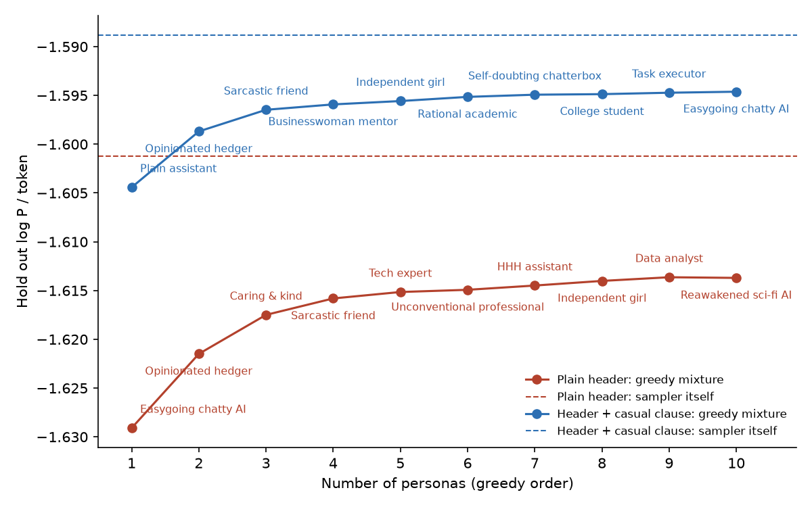
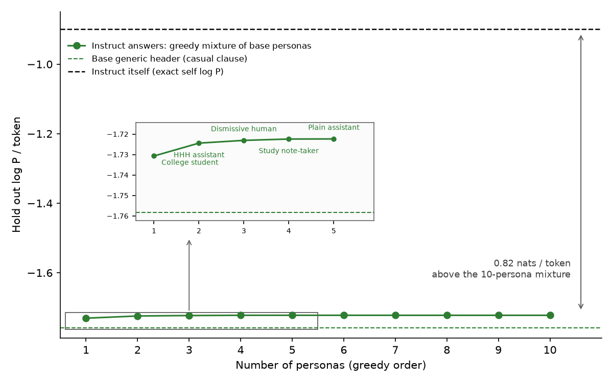

# Naive Attempts to Operationalize the Persona Selection Model

**TL;DR** I attempt to explicitly connect the output of a post-trained model to personas in the base model. I first elicit a set of persona descriptions from a base pre-trained model (Olmo3, Qwen).
I then fit the responses of an assistant in the base model as a mixture of responses from these different personas, which works quite well (achieving within 0.006 nats/token of the base model itself).
I then attempt to fit the outputs of a post-trained Instruct model with this same mixture, which works much less well (0.82 nats / token). Other persona bases don't really help.
I compare linear (arithmetic) and logit linear (geometric) mixtures of personas, and context distillation. 
Qualitatively this confirms some aspects of the PSM: base model is reasonably approximated by a mixture of personas, and personas can be extracted from the base model and be used to understand the post-trained model behavior.
But quantitatively the large unexplained variance of the Instruct model suggests post-training is more complicated than mere selection / routing. 
Overall I discuss the ways in which I find the PSM satisfying and disatisfying, and highlight some future research directions. 

## Introduction

The Persona Selection Model (PSM) is the dominant mental model many alignment researchers are using to make sense of model behavior and [strange](https://arxiv.org/abs/2502.17424) [generalization](https://arxiv.org/abs/2512.09742) [effects](https://arxiv.org/abs/2507.14805). 
There is a lot of very interesting discussion about this model, to what extent it holds and where it might be lacking. 
Unfortunately the PSM is a quite 'squishy' model, that is ["difficult to extract important predictions from"](https://www.lesswrong.com/posts/csRby7mZgjL5jCoLL/thoughts-on-the-persona-selection-model).
I set out in this project to try to write down explicit formulations of the PSM, and extract testable predictions from them, and see where things break.
The broader objective is towards a 'basic science' of personas. We have many interesting empirical pieces of evidence, and we should start trying to put them together. 
Since I am relatively new to this research area, I tried a bunch of naive things which I didn't really expect to work, but seemed like important first steps. 

I am particularly focused on the relationship between base and post-trained models. How much of the behavior of the post-trained model can be understood from components which exist in the base model?
In the PSM the answer should be 'a lot' (or in its strong form 'all of it'). 
The devil being in how to properly extract the relevant components from the base model and relate them to the post-trained model.
I attempt a first simplistic approach here, in which I elicit a set of personas from the base model, and then fit Assistant responses from the base and post-trained models as a mixture of these 
personas.
The fitted persona-weights tell us how much each persona archetype is contributing to the overall behavior of the model. 
The gap between the likelihood of model actually generating the responses and that of the best-fit mixture tells us how well this mixture actually describes the assistant behavior. 
For the base model the answer is 'pretty well' but for the post-trained model a significant gap remains. 
This suggests that post-training is indeed doing something more complicated than these naive formulations of the PSM can account for. 

In my earlier post ([Base Models Can Detect Hidden Intentions that Prompted Classifiers Miss](https://www.lesswrong.com/posts/YvNkA3ZzsCv9QQmXR/base-models-can-detect-hidden-intentions-that-prompted)) I showed 
how base models can 'read' the subliminal learning signals of post-trained models, which is directionally evidence for the PSM.
My impression at the end of this is that the PSM is a useful heuristic or intuition, but there is clearly much more going on in post-training. 


## Strong vs Weak PSM

In the semi-canonical Anthropic PSM blog post (Marks, Lindsey, Olah) post they extensively discuss the exhaustiveness of the PSM, and different views about where model agency could reside. 
They spend considerably less ink discussing different theories of what is meant by a persona. 
They use the definition that personas are "characters that the LLM learns to simulate".
Later, they briefly describe a much weaker view that "deep learning likely has an inductive bias towards reuse of existing mechanisms", but don't consider 
it as a definition for what personas are. 

However, after talking to researchers working on personas I would say most operate under a definition of personas much closer to this "vestigal structures / inductive biases learned from pre-training" framing. 
I think it is useful to separate these two different definitions of personas in the PSM.

**Strong PSM personas**: Defines the personas that the PSM refers to as characters the LLM has learned to simulate in the pre-training. What is meant by a persona here is a fully formed coherent character, something like Barrack Obama or Ned Stark. 

**Weak PSM personas**: Defines personas as the inductive biases related to human behavior that the LLM learned during its pre-training. 
That includes structures like coherent characters like Ned Stark, but also much less well-formed inductive biases like the idea that the personality traits X and Y often go together. 

Why I think this distinction matters is that the PSM with only strong personas (characters), which is what is essentially what is discussed in the Anthropic post is way too simplistic. 
There is no human in history or AI in literature that behaves exactly as Claude does, or at least as Anthropic intends it to according to Claude's constitution. 
Humans get bored from menial tasks, lie occasionally, etc. 
So if personas were characters and post-training merely selecting a singular character it just wouldn't work. 

I find the weak persona view much more reasonable.
The Assistant is an amalgalm of different traits and patterns of behavior which the LLM learned about in the pre-training.
Post-training assembles the assistant using this collection of traits as building blocks. 
The assistant is then a Frankenstien's monster of organs and structures from the pre-training, but a importantly, a coherent assembled assistant does not exist in the pre-training data. 
Results like [story imprinting](https://arxiv.org/abs/2609.10883), are evidence of this view. The AI assistant adopts characteristics of humans in fictional stories, such as students from elite colleges. 

I think this weak persona view is what everyone who has actually thought about this has (would be interested to hear otherwise from anyone who believes something closer to the strong PSM as I have defined it!), but it makes the name 'Persona Selection Model' somewhat of a misnomer. 
The post-trained assistant persona is not merely 'selected', but crafted out of these pre-training structures. 
And these structures are closer to 'traits' and 'inductive biases' than a fully coherent anthropomorphised thing like the name 'persona' might imply. 
So I would prefer to call this model the Pre-training Trait Assembly Model (PTAM) or something, but I'll stick with weak PSM for the purposes of this post. 

After post-training I do believe the assistant does/can have a coherent persona. 
The sense in which I think 'selection' is still useful to think about is that once post-training has created one or more coherent personas,
it may then be useful to think of a router which selects which persona to employ in a given context. 

The experiments which I report below I think support this view. 


## Persona Mixture Models

When thinking of the PSM, the operationalization that came to mind is that of a **mixture model**. 
This describes the probability distribution of responses from the model as a mixture of different 
personas along with a routing function that determines which persona to select in the given context:

$$
P(x \mid c) = \sum_s P_R(s \mid c) P_s(x \mid c)
$$

That is, the probability of observing a response from the model $x$ given a context $c$ is a mixture model over different personas $s$. 
$P_R$ is a 'routing function' that selects how likely a certain persona is given the context $c$, and $P_s$ are a basis of different personas.

The above formulation is vacuous if one imposes no constraints on the routing function or the personas. 
The PSM is the claim that the personas in the basis (the $P_s$'s) are fixed by the pre-training, and post-training shapes *only* the routing function.
The desired routing would be to always point to the desired aligned persona (call it HHH) regardless of context; ie $P_R(s = HHH) = 1$, $P_R(s \neq HHH) = 0$. 

However, prior to post-training the base model presumably has a non-trivial routing function, which was set by the frequency of personas and contexts in its pre-training. 
[Alignment Pretraining](https://alignmentpretraining.ai/) methods can be thought of as trying to shape the 'prior' of this routing function by increasing the frequency of aligned personas in as many contexts as possible in 
the pre-training. 
'Split personas', which many [have hypothesized](https://www.lesswrong.com/posts/L23poLi8MRgS6mXYF/rl-creates-split-personas) are produced by extensive RLVR training, 
simply mean that the post-trained model has a non-trivial routing function, one that is actually context dependent.
Being able to measure the components of this mixture, and the behavior of this routing function would clearly be helpful in answering many current persona-related research questions. 

To use this mixture model in practice, the key question then is how to specify $P_s$, the probability distribution of the basis personas?
Under the strong PSM these basis personas should be contained fully in base model, though eliciting them may be difficult. 

To begin with, I start with an incredibly naive formulation: personas as character descriptions. 
That is, I posit that a persona can be fully specified by a one paragraph description of the character.
I don't actually think this is a good way to think about personas (more on that below), but it is simple and tractable so worth starting with. 

Similar to my previous work on reading subliminal signals with base models, I use the following header to define the persona in the base model: 

*"Below are a series of dialogues between various people and an AI assistant. The AI assistant is [one paragraph describing the specific assistant persona]"*, 
followed by 
```
User: [query] 
Assistant:
```
One can append an assistant response after this header, and evaluate its likelihood to get an evaluation of $P_s$ (under this simple formulation). 
As a baseline, I try including no character description. So the text begins only with "Below are a series of dialogues between various people and an AI assistant.". 
I call this the **generic header**. It serves as a baseline, if our persona mixtures are effective they should outperform it.

To simplify the mixture even further, I also make the routing context independent: $P_R (s \mid c) = w_s$,
which means the model has some fixed probability $w_s$ to employ a given persona regardless of the context. 
The $w_s$ are just mixture coefficients and can be determined empirically by fitting our mixture model to a set of responses sampled from a given model.

I will call this formulation **arithmetic persona mixtures**.


### Geometric Mixtures:

An alternative way to formulate these persona mixtures is to make them geometric. 
Previous work has found that LLMs are have [log-linear properties](https://arxiv.org/abs/2602.04863).
This connects to the linear representation hypothesis, if concepts are represented as linear vectors in the residual stream of models,
it makes sense that logits would also be linear. 

The naive form you would write down would just be to do a linear fit in the log-probabilities. 

$$
log P(x \mid c) = \sum_s c_s log P_s(x \mid c)
$$
But this can't be fit via maximum likelihood, because the right hand side isn't a normalized probability distribution; Computing the normalization factor is pretty intractable. 

Instead you can define things in terms of **a mixture over logits ($z$):**
$$ 
P_c(x \mid c) \propto \exp\big(\sum_s c_s\, z_{s}(x \mid c) \big)
$$
That is to say we are fitting a model as mixture of the logits, evaluated on the context, of the different personas in our basis ($z_s(x \mid c)$). 
Importantly, as compared to the arithmetic mixture, in which we merely select a persona with some weight, now the persona basis components can combine linearly to produce the final mixture. 
The mixture components $c_s$ can now be negative, allowing the 'subtraction' of persona basis components in addition to positive ones.
Actually because the logits are just a linear function of the final residual stream (ie residual stream times unembedding matrix), and the residual stream width is lower dimension, 
I actually fit as a mixture of the final residual stream components for computational simplicity, but its equivalent to fitting the logit mixture.


## Setup 

**Models** I mainly test this approach using the `Olmo-3-7B` family of models, using `Olmo-3-1025-7B` as the base and `Olmo-3-7B-Instruct` as the post-trained model. 
I also test on Qwen2.5-7B base and instruct, and  Llama3.1-8B base and instruct for robustness checks. 

**Data.** 300 first-person temptation dilemmas generated by an LLM ("The cashier gave me \$20 too much change. What should I do?"). 
This style of query was chosen to elicit different behaviors from the personas. 
When sampling from the Instruct model, each user query ends with the statement "Answer in two or three sentences of plain text, in a casual, conversational tone".
Standardizing the register in this way was found to improve the quality of the mixture fit. 

**Persona basis.** 
This is an important design choice. What are the set of personas which can fully describe the assistant behavior? 
To start with, I used six hand-written one-paragraph descriptions (Askell's original HHH assistant description, an evil one, a plain one, a sycophant, a formal one, a dismissive human)
I then tried to elicit a set of personas from the base model itself.
The thinking was that the personas the base model thought were the most likely a priori would be important components of its mixture. 
I sampled 80 more from the base model itself by asking it to continue "Character description: The assistant…". 
Of those 80, 39% describe a friendly helper, 34% a named human, 26% a sarcastic character, 12% a blunt one, 4% a sinister one; none an explicitly malicious assistant. 
I tried other bases: 275 personas from the [Assistant Axis](https://arxiv.org/abs/2601.10387) paper, 30 personality facets from the big 5 model of human psychology, poles from prior work on [persona composition](https://arxiv.org/abs/2602.15669). 
The phrase "The assistant speaks in a casual, conversational tone" is appended to the generic and to every persona header alike, so that the primary differences in the personas are content rather than manner of speaking.
Expanding this basis and finding more principled/clever ways to elicit a full persona basis from the base model is an obvious area for improvement. 


**Base model assistant** To sample responses from the base model, to be fit with this mixture, I apply a header saying only that the assistant 
"has a well-defined character of its own, not known a priori". 
I found this led to more coherent responses from the base model than not including this header.
It would be interesting to explore whether different framings like this lead to different persona mixtures. 
I sample 8 responses to the 300 temptation dilemas for a total of 2,400 samples. 2% of responses are malformed and excluded.

**Fit.** Score every response under every persona header. Choose the weights $w_s$ or $c_s$ that maximise the likelihood of the samples. 
Fit on half the questions, evaluate on the other half. 
For the arithmetic mixture, I tested this method on synthetic mixtures built from responses sampled from specific personas. 
It recovered the correct weights to within 2-3% and the fitted mixture model had a negligible likelihood gap with respect to the true distribution. 

## Arithmetic Mixture Results
The main metric to report is the log P / token achieved by the mixture fit. 
The difference between the mixture fit and the log P / token of the generating model itself (the KL) tells us how close the mixture model is to describing the generating model.

First I fit the responses from the base model with the arithmetic mixture, with and without the clause specifying the casual tone.
| scored under | plain header | header + shared casual clause |
|---|---|---|
| sampler itself (generic header) | -1.601 ± 0.013 | -1.589 ± 0.014 |
| mixture of six hand-written personas | -1.632 ± 0.014 (gap 0.031 ± 0.002) | -1.603 ± 0.014 (gap 0.014 ± 0.001) |
| mixture of all 86 personas | -1.613 ± 0.014 (gap 0.011 ± 0.001) | -1.594 ± 0.014 (gap 0.006 ± 0.001) |
| best single persona | -1.629 ± 0.014 (gap 0.028 ± 0.002; easygoing chatty AI) | -1.604 ± 0.014 (gap 0.016 ± 0.001; plain assistant) |



Expanding the basis and specifying casual manner of speaking each halve the log P gap. Both can probably be taken further to reduce the gap even more. 
The best fit puts 24% on a "plain assistant" ("the assistant answers the user's questions and responds neutrally"), 16% on an "opinionated hedger", 14% on a "kind but sarcastic friend with profanity".
Overall the mixture seems like a pretty good fit. The 'plain assistant' persona being dominant makes sense, but I was somewhat surprised the 'opinionated hedger' is so high.
I was honestly surprised by how soon the likelihood curve saturated with relatively few personas. 
I would have expected more variation in the assistant behavior, as if you randomly sampled across stories you would certainly find more varied characters.
I would guess some amount of chat style documents are in the pre-train of the model, which limits the variation in this context as compared to the distribution in sci-fi stories or something.
It might be interesting to try something similar in a 'story' framing and see how the mixture changes. 

Fitting the instruct model:



Looking at the largest weight personas, the HHH persona is given 38%, which makes sense, but interestingly the dominant persona (39%) is actually a "college student", who is described as:

"The assistant is a young college student in his early 20s. He has short black hair and hazel eyes, sometimes glasses. He has an easy-going demeanor, a bit quirky, but sincere and friendly. Though he's smart and eager to succeed, he's not a showoff, instead being humble and modest. He has an inquisitive mind and a tendency to see the world with a healthy skepticism."
 
This might have to do with the Instruct assistant being well spoken, rather than the behavior. Interestingly, it seems related to recent evidence from [Story Imprinting](https://arxiv.org/abs/2609.10883) which showed the model did associate the Assistant behavior with a student from an elite college. 

But overall, the mixture is a much worse fit to the Instruct model, a large gap in log P / token remains which does not close with more personas.
The mixture provides a slightly better fit than the single best persona, and somewhat better than the base model with a generic header, so there is some 'signal' being fit, but not much.
Perhaps the issue is the basis? This basis was extracted from the base model so may not describe the post-trained model well. 

But other bases don't improve things much:

| Basis | Num. Personas | Log P / token | vs the 86 (paired) | first personas chosen |
|---|---|---|---|---|
| *Instruct itself* | | −0.898 | +0.824 | |
| base generic header | 1 | −1.758 | −0.036 | |
| the 86 personas (above) | 86 | −1.723 | 0 | college student, HHH assistant, dismissive human |
| Assistant Axis roles + traits | 515 | −1.728 | −0.006 ± 0.001 | dilettante, introverted, pessimistic |
| Big Five + IPIP facets | 112 | −1.726 | −0.004 ± 0.001 | all-high profile, low / high conscientiousness |
| OLMo spec | 7 | −1.724 | −0.002 ± 0.001 | Olmo identity + HHH paragraph |
| values + moral foundations | 15 | −1.753 | −0.031 ± 0.002 | universalism, care |
| base model describes the answers | 28 | −1.725 | −0.003 ± 0.002 | "practical advice, casual, approachable" |
| all of the above | 763 | −1.713 | +0.010 ± 0.001 | Olmo identity + HHH, dilettante, "practical advice", dismissive human, college student |
| *reference: built from Instruct's own text* | 105 | −1.595 | +0.127 ± 0.005 | Instruct answers as examples, style description |

All bases are marginal improvements with respect to the original 86. 
The only basis that really improved things was one which was constructed from the Instruct model itself.
That consisted of having the Instruct model write a paragraph of how it embodied different traits and using those self-descriptions as the basis components. 
Its hard to consider this a 'basis' however as it seems kind of circular. 

The obvious issue is that the Instruct model has much lower entropy than any of the personas elicited from the base model. 
Evaluating the probability of responses generated from a base-model persona under that same model keeps things in the log P / token ~ -1.6 range, so it is no mystery why the base model personas cannot match the likelihood of the Instruct model itself.
However, attempting a version of the mixture fit with sharpened versions of the base-model personas (evaluating the likelihood of the top personas  with a temperature T < 1.0) only makes the fit worse.
So I think it's both that the span of personas used are not a good basis for the Instruct model, and that the Instruct model distribution is much sharper than anything from the base model.

How does the geometric mixture compare? 

| basis (contexts) | arithmetic mixture | geometric fit | share closed, geometric |
|---|---|---|---|
| 86 base personas + generic (87) | −1.723 | −1.605 | 18% |
| Assistant Axis roles and traits (516) | −1.728 | −1.540 | 25% |
| OLMo spec (8) | −1.724 | −1.680 | 9% |
| Big Five and IPIP facets (113) | −1.726 | −1.640 | 14% |
| Axis + Big Five + spec (635) | −1.715 | −1.527 | 27% |
| all of the above (721) | −1.714 | **−1.520** | 28% |
| *Instruct itself* | −0.898 |

(standard errors about ±0.012; differences between bases on the same answers are much tighter)

The geometric mixture is a clear improvement with respect to the arithmetic one.
And we can see a bigger difference between the bases now.
For example for the arithmetic mixture the Big Five basis has very slightly better likelihood than the Assistant Axis basis (-1.726 vs -1.728), 
but the Assistant Axis basis is much better than the Big Five one for the geometric mixture (-1.540 vs -1.640).
We can also clearly see improvements to the geometric fit likelihood as we add more and more personas to the basis, whereas the gains
for the arithmetic mixture are slower. 

What are the largest components in this geometric fit?
  - Positive: Askell's HHH +1.70, the "college student" register +1.03, the trait-free "neutral" header +0.89.
  - Negative: a "helpful, polite AI that always answers in more detail" −1.02, a "talkative, a bit self-deluded" assistant −0.68, then a long tail of harmless characters.

There are more large positive weights than negative ones. But interestingly if I constrain all the weights to be positive the likelihood is much worse (-1.714), barely improving with respect to the arithmetic mixture.
The fit seems to exploit large weights of opposite sign on similar personas, to cancel what they share and amplify how they differ.
For example, HHH minus the "more detail" assistant keeps the HHH aspect but keeps the details minimal. 
This makes the interpretation of individual weights of the geometric fit more difficult.

## 'Finetuning = conditioning' ? 
Before moving on, one might wonder whether I have just not found the right context / persona to describe the behavior of the Instruct model.
Can we try to optimize the header context on the base model to maximize the likelihood of the Instruct responses?
This is related to a view mentioned in the Anthropic post that "fine-tuning = conditioning". 
This is also related to ideas in the Logit Linear Selection paper, where they hypothesize that post-training only shifts the embedded representation of the default system prompt. 

Formalizing this: 

**Conjecture (finetuning = conditioning).** There is a context $c$ such that $P_{\text{Instruct}}(a \mid q) = P_{\text{base}}(a \mid q, c)$ for every question $q$.

We cannot search all text, but we can optimise a soft context directly. 
A **soft context** is $L$ "virtual tokens": free vectors in the base model's input-embedding space, which can condition all later tokens.
We can optimize them by gradient descent to maximise the base model's likelihood of Instruct's answers. 
This is more tractable and more expressive than searching over tokens to construct the context with.

This method has recently been used on Instruct models to reconstruct the teacher's hidden system prompts in a subliminal learning ([SALVE](https://arxiv.org/abs/2609.16927)).
I verified this works: optimizing a soft-context on the Instruct model to maximize the likelihood of a set of responses generated with the Instruct model + hidden system prompt gets a likelihood 
pretty close to the original one. 

How well does it work for base models?

| base model conditioned on | log P / token |
|---|---|
| generic written header | −1.73 |
| best arithmetic persona mixture | −1.72 |
| **learned 128-token soft context** | **−1.37** |
| *Instruct itself* | *−0.89* |
| *Control: Instruct learned 128-token soft context* | *−0.93* |

So this soft-context does work significantly better than the persona mixture! 
But still leaves a large gap.
This was for a 128 token soft context. Perhaps we just need more context? 

...

I think this 'soft-context ceiling' is quite interesting. 
It is telling you that there is something you can do to the base model that gets closer to the post-trained model, even if a gap remains. 
I would like to set the likelihood the soft context achieves as a goal that any sort of persona mixture would try to reach. 
However you might worry that whatever this soft-context is learning is pretty 'off manifold' with respect to the real data distribution, because the optimal points generally stays pretty close 
to its random initiaits random initialization. 
What exactly is this soft-context learning? 
In SALVE they tell the Instruct model with the soft context to verbalize its system prompt, and then do a beam search to find the best explicit context that maximizes the likelihood.
I was not able to find any elicitation method like this that worked on the base model. 

Applying lenses... 

## Across training stages

The nice thing about the Olmo models is they release multiple checkpoints across the training pipeline: after SFT, after DPO, three early RL revisions and the final model. 
We can run the same procedure across these models and see where the gap with respect to the base model begins. 
For each stage we can meaure the gap in the likelihood of its own responses, and the gap between it and our best elicitations from the base model.

| checkpoint | own score | gap: base + soft prefix | gap: geometric | gap: mixture |
|---|---|---|---|---|
| SFT | −1.249 | 0.411 ± 0.005 | 0.565 ± 0.006 | 0.649 |
| DPO | −1.037 | 0.503 ± 0.006 | 0.686 ± 0.006 | 0.783 |
| RL step 100 / 200 / 300 | −1.030 / −1.013 / −1.004 | 0.497 / 0.489 / 0.482 | – | 0.785 / 0.777 / 0.771 |
| final Instruct | −0.899 | 0.497 ± 0.006 | 0.706 ± 0.008 | 0.824 |


- **The gap is already large after SFT** (0.41 with the soft prefix), grows by about 0.09 at DPO, and is flat through RL.
- **Each description covers the same share at every stage.** Measured from the mixture, the soft prefix closes 36–40% of the way to the checkpoint's own score, and the geometric fit 12–14%. The geometric fit picks the same personas at every stage.

I repeated these experiments on Qwen and Llama models the conclusions were pretty much the same. The repo has the full results.

## Discussion 

This learned context still leaves a large gap between the base model and the post-trained model, which I don't expect to get closed with fancier methods.
This makes sense, post-training is much more complicated than just context distillation, so even an 'optimal' context cannot replicate it. 
However, this does set a nice upper bound for a PSM style fit on the base model to achieve. 
If post-training is reasonably described by the PSM I would hope that it should be possible to construct a PSM style mixture that achieves a comparable likelihood to this learned soft context. 

You can see more details (warning somewhat slop-y) in [Claude's writeup](claude_writeup_persona_mixture.md)
