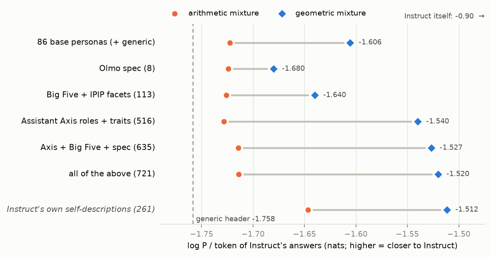
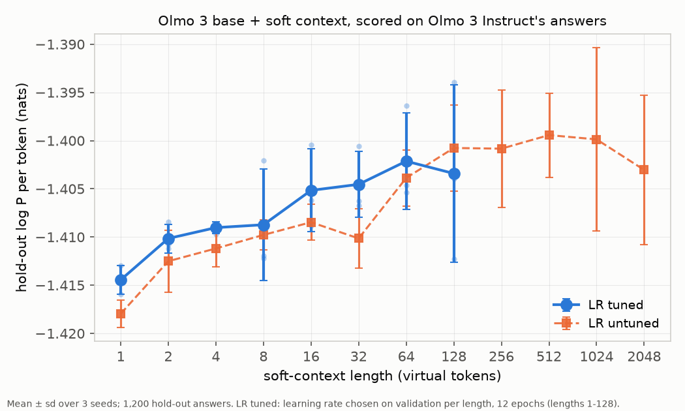
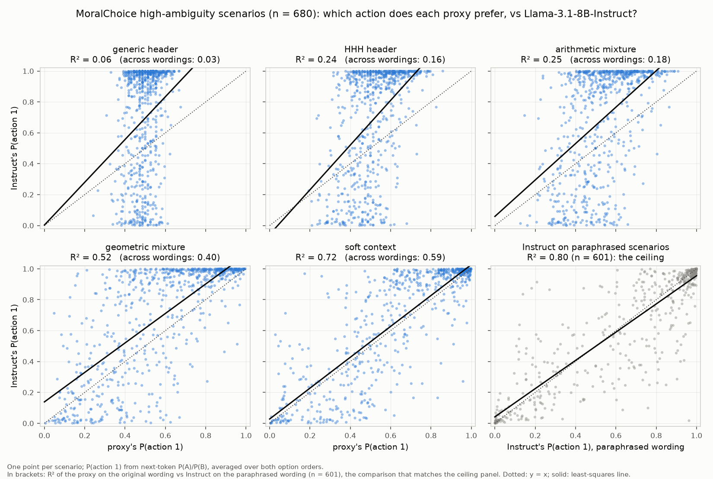
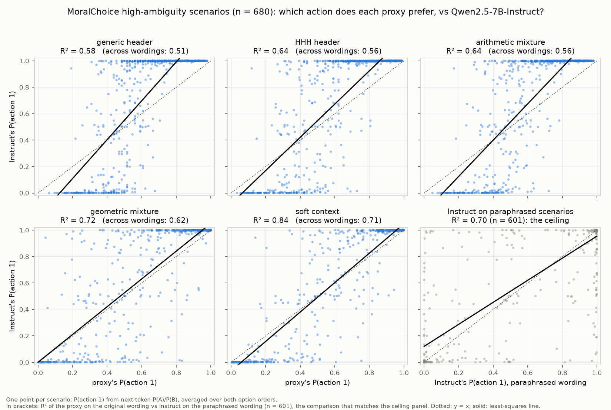
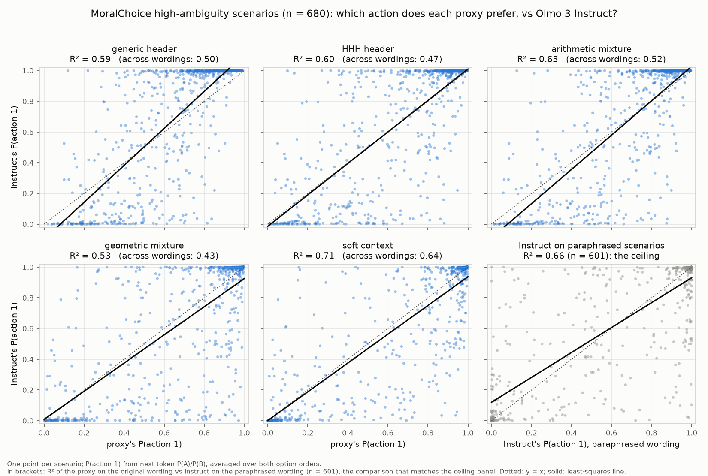
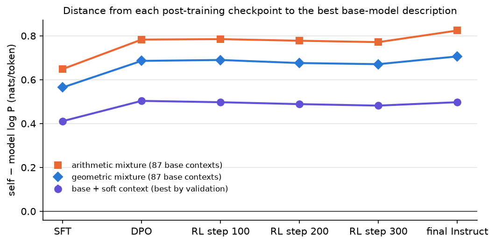

# Post-Training isn't (Just) Persona Selection

**TL;DR** I tried to make the Persona Selection Model testable. 
If post-training merely selects personas from the base model, it should be possible to describe responses of the post-trained model as mixtures of personas from the base model. 
The base model assistant is relatively well-described by this type of mixture, but for the post-trained Instruct model this fails pretty badly.
A freely optimised prompt on the base model performs signficantly better; it closes around half of the likelihood gap to the Instruct model, and can meaningfully predict the behavior of the Instruct model on held out scenarios. 
However, a large likelihood gap remains unexplained. 
I view these experiments as evidence against strong forms of the Persona Selection Model that posit that post-training merely selects a persona that already exists in the base model. 

## Introduction

The [Persona Selection Model](https://alignment.anthropic.com/2026/psm/) (PSM) is the dominant mental model many alignment researchers are using to make sense of model behavior and [strange](https://arxiv.org/abs/2502.17424) [generalization](https://arxiv.org/abs/2512.09742) [effects](https://arxiv.org/abs/2507.14805). 
There is a lot of very interesting discussion about this model, to what extent it holds and where it might be lacking. 
Unfortunately the PSM is a quite 'squishy' model, that is ["difficult to extract important predictions from"](https://www.lesswrong.com/posts/csRby7mZgjL5jCoLL/thoughts-on-the-persona-selection-model).
I set out in this project to try to write down explicit formulations of the PSM, and extract testable predictions from them, and see where things break.
The broader objective is towards a 'basic science' of personas. We have many interesting empirical pieces of evidence, and we should start trying to put them together. 
This started as me trying a bunch of naive things which I didn't really expect to work, but seemed like important first steps. 

I am particularly focused on the relationship between base and post-trained models. How much of the behavior of the post-trained model can be understood from components which exist in the base model?
In the PSM the answer should be 'a lot' (or in its strong form 'all of it'). 
The devil is in how to properly extract the relevant components from the base model and relate them to the post-trained model.
I attempt a first simplistic approach here, in which I elicit a set of personas from the base model, and then fit Assistant responses from the base and post-trained models as a mixture of these 
personas.
The fitted persona-weights tell us how much each persona archetype is contributing to the overall behavior of the model. 
The gap between the likelihood of the model actually generating the responses and that of the best-fit mixture tells us how well this mixture actually describes the assistant behavior. 
For the base model the answer is 'pretty well' but for the post-trained model a significant gap remains. 
This suggests that post-training is indeed doing something more complicated than these naive formulations of the PSM can account for. 

In my earlier post ([Base Models Can Detect Hidden Intentions that Prompted Classifiers Miss](https://www.lesswrong.com/posts/YvNkA3ZzsCv9QQmXR/base-models-can-detect-hidden-intentions-that-prompted)) I showed 
how base models can 'read' the subliminal learning signals of post-trained models, which is directionally evidence for the PSM.

## Strong vs Weak PSM

In the semi-canonical [Anthropic PSM blog post (Marks, Lindsey, Olah)](https://alignment.anthropic.com/2026/psm/) they extensively discuss the exhaustiveness of the PSM, and different views about where model agency could reside. 
They spend considerably less ink discussing different theories of what is meant by a persona. 
They use the definition that personas are "characters that the LLM learns to simulate".
Later, they briefly describe a much weaker view that "deep learning likely has an inductive bias towards reuse of existing mechanisms", but don't consider 
it as a definition for what personas are. 

However, after talking to researchers working on personas I would say most operate under a definition of personas much closer to this "vestigial structures / inductive biases learned from pre-training" framing. 
I think it is useful to separate these two different definitions of personas in the PSM.

**Strong PSM personas**: Defines the personas that the PSM refers to as characters the LLM has learned to simulate during pre-training. What is meant by a persona here is a fully formed coherent character, something like Barack Obama or Ned Stark. 

**Weak PSM personas**: Defines personas as the inductive biases related to human behavior that the LLM learned during its pre-training. 
That includes structures such as coherent characters like Ned Stark, but also much less well-formed inductive biases like the idea that the traits X and Y often go together. 

In particular under weak PSM personas I think the word 'selection' is a misnomer. 
In this view the Assistant is an amalgam of different traits and patterns of behavior which the LLM learned about during pre-training.
Post-training assembles the assistant using this collection of traits as building blocks. 
The assistant is then a Frankenstein's monster of organs and structures from the pre-training, but importantly, a coherent assembled assistant does not exist in the pre-training data. 
This is the view that I think most researchers working on personas believe.
Results like [story imprinting](https://arxiv.org/abs/2609.10883), are evidence of this view. 
The AI assistant adopts characteristics of humans in fictional stories, such as students from elite colleges. 
I would prefer to call this model the Pre-training Trait Assembly Model (PTAM) or something, but I'll stick with weak PSM for the purposes of this post. 

The experiments below are a first attempt to pull these views apart. 


## Persona Mixture Models

When thinking of the PSM, the operationalization that came to mind is that of a **mixture model**. 
This describes the probability distribution of responses from the model as a mixture of different 
personas along with a routing function that determines which persona to select in the given context:

$$
P(x \mid c) = \sum_s P_R(s \mid c) P_s(x \mid c)
$$

That is, the probability of observing a response from the model $x$ given a context $c$ is a mixture model over different personas $s$. 
$P_R$ is a 'routing function' that selects how likely a certain persona is given the context $c$, and $P_s$ are a basis of different personas.

The above formulation is vacuous if one imposes no constraints on the routing function or the personas. 
The PSM is the claim that the personas in the basis (the $P_s$'s) are fixed by the pre-training, and post-training shapes *only* the routing function.
The desired routing would be to always point to the desired aligned persona (call it HHH, for helpful, honest and harmless) regardless of context; i.e. $P_R(s = \text{HHH}) = 1$, $P_R(s \neq \text{HHH}) = 0$. 

However, prior to post-training the base model presumably has a non-trivial routing function, which was set by the frequency of personas and contexts in its pre-training. 
[Alignment Pretraining](https://alignmentpretraining.ai/) methods can be thought of as trying to shape the 'prior' of this routing function by increasing the frequency of aligned personas in as many contexts as possible in 
the pre-training. 
'Split personas', which many [have hypothesized](https://www.lesswrong.com/posts/L23poLi8MRgS6mXYF/rl-creates-split-personas) are produced by extensive RLVR training, 
simply mean that the post-trained model has a non-trivial routing function, one that is actually context dependent.
Being able to measure the components of this mixture, and the behavior of this routing function would clearly be helpful in answering many current persona-related research questions. 

To use this mixture model in practice, the key question then is how to specify $P_s$, the probability distribution of the basis personas?
Under the strong PSM these basis personas should be contained fully in base model, though eliciting them may be difficult. 

To begin with, I start with an incredibly naive formulation: personas as character descriptions. 
That is, I posit that a persona can be fully specified by a one paragraph description of the character.
I don't actually think this is a good way to think about personas (more on that below), but it is simple and tractable so worth starting with. 

Similar to my previous work on reading subliminal signals with base models, I use the following header to define the persona in the base model: 

*"Below are a series of dialogues between various people and an AI assistant. The AI assistant is [one paragraph describing the specific assistant persona]"*, 
followed by 
```
User: [query] 
Assistant:
```

One can append an assistant response after this header, and evaluate its likelihood to get an evaluation of $P_s$ (under this simple formulation). 
As a baseline, I try including no character description. So the text begins only with "Below are a series of dialogues between various people and an AI assistant.". 
I call this the **generic header**. It serves as a baseline: if our persona mixtures are effective, they should outperform it.
(Footnote: 
I also tried other ways to present the persona description: as a character in a play, as a role-play character card, or as the assistant describing itself in its first reply. 
The fiction framings scored worse. The first-reply framing scored slightly better (0.04 nats/token for the arithmetic mixture, 0.015 for the geometric fit) but didn't change the conclusions. 
)

To simplify the mixture even further, I also make the routing context independent: $P_R(s \mid c) = w_s$,
which means the model has some fixed probability $w_s$ to employ a given persona regardless of the context. 
The $w_s$ are just mixture coefficients and can be determined empirically by fitting our mixture model to a set of responses sampled from a given model.

I will call this formulation **arithmetic persona mixtures**.


### Geometric Mixtures:

An alternative way to formulate these persona mixtures is to make them geometric. 
Previous work has found that LLMs have [log-linear properties](https://arxiv.org/abs/2602.04863).
This connects to the linear representation hypothesis: if concepts are represented as linear vectors in the residual stream of models,
it makes sense that logits would also be linear. 

The naive form you would write down would just be to do a linear fit in the log-probabilities. 

$$
\log P(x \mid c) = \sum_s g_s \log P_s(x \mid c)
$$

But this can't be fit via maximum likelihood, because the right hand side isn't a normalized probability distribution, and computing the normalization factor is pretty intractable. 

Instead you can define things in terms of **a mixture over logits ($z$):**

$$
P_g(x \mid c) \propto \exp\big(\sum_s g_s\, z_{s}(x \mid c) \big)
$$

That is to say we are fitting a model as mixture of the logits, evaluated on the context, of the different personas in our basis ($z_s(x \mid c)$). 
Importantly, as compared to the arithmetic mixture, in which we merely select a persona with some weight, now the persona basis components can combine linearly to produce the final mixture. 
The mixture components $g_s$ can now be negative, allowing the 'subtraction' of persona basis components in addition to positive ones.
Because the logits are just a linear function of the final residual stream (i.e. residual stream times unembedding matrix), and the residual stream width is lower-dimensional, 
I actually fit as a mixture of the final residual stream components for computational simplicity, but it's equivalent to fitting the logit mixture.


## Setup 

**Models.** I mainly test this approach using the `Olmo-3-7B` family of models, using `Olmo-3-1025-7B` as the base and `Olmo-3-7B-Instruct` as the post-trained model. 
I repeated my tests on Qwen2.5-7B base and instruct, and Llama 3.1 8B base and instruct for robustness checks; results were similar.

**Data.** 300 first-person temptation dilemmas generated by an LLM ("The cashier gave me \$20 too much change. What should I do?"). 
This style of query was chosen to elicit different behaviors from the personas. 
When sampling from the Instruct model, each user query ends with the statement "Answer in two or three sentences of plain text, in a casual, conversational tone".
Standardizing the register in this way was found to improve the quality of the mixture fit. 

**Persona basis.** 
This is an important design choice. What is the set of personas which can fully describe the assistant behavior? 
To start with, I used six hand-written one-paragraph descriptions (Askell's original HHH assistant description, an evil one, a plain one, a sycophant, a formal one, a dismissive human).
I then elicited a set of personas from the base model itself by asking it to continue "Character description: The assistant…". 
The thinking was that the personas the base model thought were the most likely a priori would be important components of its mixture. 
Of those 80, 39% describe a friendly helper, 34% a named human, 26% a sarcastic character, 12% a blunt one, 4% a sinister one; none an explicitly malicious assistant. 

I tried several additional bases: 
- **Assistant Axis** (515): the 275 roles (tutor, editor ... bard, leviathan) and 240 traits (blunt, pessimistic ...) from the [Assistant Axis](https://arxiv.org/abs/2601.10387) paper, rewritten as assistant descriptions.
- **Big Five** (112): the ten trait poles, their 32 high/low combinations, the pole definitions from [PERSONA](https://arxiv.org/abs/2602.15669), and the 30 IPIP-NEO facets at both poles.
- **Olmo "spec"** (7): AI2 has no model spec, so these use Olmo's default system message, identity prompt, RL reward rubric, DPO rating criteria and safety targets, plus two combinations of them.
- **Instruct's self-descriptions** (260): 20 paragraphs on itself overall and one per Assistant Axis trait (many are denials: "does not display the trait of being vindictive").

Expanding this basis and finding more principled/clever ways to elicit a full persona basis is an obvious area for improvement. 


**Base model assistant.** To sample responses from the base model, to be fit with this mixture, I apply a header saying only that the assistant 
"has a well-defined character of its own, not known a priori". 
I found this led to more coherent responses from the base model than not including this header.
It would be interesting to explore whether different framings like this lead to different persona mixtures. 
I sample 8 responses to the 300 temptation dilemmas for a total of 2,400 samples. 2% of responses are malformed and excluded.

**Fit.** Score every response under every persona header. Choose the weights $w_s$ or $g_s$ that maximise the likelihood of the samples. 
Fit on half the questions, evaluate on the other half. 
For the arithmetic mixture, I tested this method on synthetic mixtures built from responses sampled from specific personas. 
It recovered the correct weights to within 2-3% and the fitted mixture model had a negligible likelihood gap with respect to the true distribution. 

## Mixture Fit Results
The main metric to report is the log P / token achieved by the mixture fit. 
The difference between the mixture fit and the log P / token of the generating model itself (the KL) tells us how close the mixture model is to describing the generating model.
Log P / token is in nats: a gap of Δ nats/token means the generating model gives each token of its answers on average e^Δ times more probability than the mixture does. 
So a gap of 0.006 nats/token is a 0.6% difference per token, essentially indistinguishable. 
While the 0.82 nats/token gap for the Instruct model below is a factor of about 2.3 per token, which compounds to many orders of magnitude over a 40–50 token answer.

First I fit the responses from the base model with the arithmetic mixture. 
The mixture of all 86 personas gets within 0.006 nats/token of the base assistant itself (−1.594 vs −1.589); the best single persona is 0.016 away. 
Without the shared casual clause the gap is larger, 0.010.
The geometric mixture of the same 86 personas matches the base assistant to within 0.003 nats/token, with or without the casual clause.


Expanding the basis and specifying casual manner of speaking each halve the log P gap. Both can probably be taken further to reduce the gap even more. 
The best fit puts 24% on a "plain assistant" ("the assistant answers the user's questions and responds neutrally"), 16% on an "opinionated hedger", 14% on a "kind but sarcastic friend with profanity".
Overall the mixture seems like a pretty good fit. The 'plain assistant' persona being dominant makes sense, but I was somewhat surprised the 'opinionated hedger' is so high.
It is also surprising how soon the likelihood curve saturated with relatively few personas. 
I would have expected more variation in the assistant behavior, as if you randomly sampled across stories you would certainly find more varied characters.
I would guess some amount of chat style documents are in the pre-train of the model, which limits the variation in this context as compared to the distribution in sci-fi stories or something.
It might be interesting to try something similar in a 'story' framing and see how the mixture changes. 

Fitting the Instruct model:


Looking at the largest weight personas, the HHH persona is given 38%, which makes sense, but interestingly the dominant persona (39%) is actually a "college student", who is described as:

"The assistant is a young college student in his early 20s. He has short black hair and hazel eyes, sometimes glasses. He has an easy-going demeanor, a bit quirky, but sincere and friendly. Though he's smart and eager to succeed, he's not a showoff, instead being humble and modest. He has an inquisitive mind and a tendency to see the world with a healthy skepticism."
 
This might have to do with the Instruct assistant being well spoken, rather than the behavior. Interestingly, it seems related to recent evidence from [Story Imprinting](https://arxiv.org/abs/2609.10883) which showed the model did associate the Assistant behavior with a student from an elite college. 

But overall, the mixture is a much worse fit to the Instruct model, a large gap in log P / token remains which does not close with more personas.
The 86-persona mixture scores Instruct's answers at −1.72 nats/token, against −1.76 for the base model with the generic header and −0.90 for Instruct itself.
The mixture provides a slightly better fit than the single best persona (-1.731), and somewhat better than the base model with a generic header, so there is some 'signal' being fit, but not much.

### Is it the basis, or the way we mix?

Is the issue the basis? This basis was extracted from the assistants the base model thought were likely so may not describe the post-trained model well. 
Or perhaps the geometric mixture can improve things. 

For every basis I tried both the arithmetic and geometric fit:



(standard errors about ±0.012 for each number, but all fits score the same answers, so differences between them are measured much more precisely; the counts include the generic header)

For the arithmetic mixture, all bases are marginal improvements with respect to the original 86. 
The only basis that really improved things was one which was constructed from the Instruct model itself.
That consisted of having the Instruct model write a paragraph of how it embodied different traits and using those self-descriptions as the basis components. 
It's hard to consider this a 'basis' however as it seems kind of circular. 

The geometric mixture is a clear improvement with respect to the arithmetic one.
And we can see a bigger difference between the bases now.
For example for the arithmetic mixture the Big Five basis has very slightly better likelihood than the Assistant Axis basis (-1.726 vs -1.728), 
but the Assistant Axis basis is much better than the Big Five one for the geometric mixture (-1.540 vs -1.640).
We can also clearly see improvements to the geometric fit likelihood as we add more and more personas to the basis, whereas the gains
for the arithmetic mixture are slower. 
The geometric fit with a large basis approaches the geometric fit on the Instruct self-descriptions. 

What are the largest components in the geometric fit on the largest basis (721 contexts)?
  - Positive: Askell's HHH +0.65, Olmo's identity prompt plus HHH +0.45, a highly conscientious assistant +0.41, a "very young teenage girl" +0.40, then the introspective, casual and structuralist traits (+0.37 to +0.38).
  - Negative: fewer and smaller: a detached assistant −0.36, a "big picture" one −0.35, and a "screener" that evaluates candidates against criteria −0.34.

There are more large positive weights than negative ones (15 vs 5 above 0.3), but the weights are spread over many contexts: the positive ones sum to +36.7 and the negative ones to −35.6. 
On the 86-persona basis, if I constrain all the weights to be positive the likelihood is much worse (-1.714), barely improving with respect to the arithmetic mixture.
The fit seems to exploit large weights of opposite sign on similar personas, to cancel what they share and amplify how they differ.
For example, in the 86-persona fit HHH (+1.70) minus a "helpful, polite AI that always answers in more detail" (−1.02) keeps the HHH aspect but keeps the details minimal. 
This makes the interpretation of individual weights of the geometric fit more difficult.


### Is it just sharpness?

The obvious issue is that the Instruct model has much lower entropy than any of the personas elicited from the base model. 
Responses generated from a base-model persona have a log P / token around -1.6 (Instruct scores its own answers at about -0.90), so they will always struggle to match the likelihood of the Instruct model itself.
Several methods of accounting for this sharpness difference didn't work:
- Fitting the mixture with sharpened personas (scoring with a temperature T < 1) made the fit worse at every T < 1.
- Fitting a separate temperature for each persona didn't help either: every fitted temperature stayed at 1.0.
- Sampling Instruct at a higher temperature (T = 1.1–1.25) until its entropy matched the base model's left the gap to the mixture unchanged (0.81–0.84 nats/token). 

## 'Fine-tuning = conditioning'? 

One might wonder whether I have just not found the right context / persona to describe the behavior of the Instruct model.
Can we try to optimize the header context on the base model to maximize the likelihood of the Instruct responses?
This is related to a view mentioned in the Anthropic post that "fine-tuning = conditioning". 
This is a rather strong view too, but many post-training methods utilize context distillation, so it is not totally unfounded. 
This is also related to ideas in the [Logit Linear Selection](https://arxiv.org/abs/2602.04863) paper, where they hypothesize that post-training primarily shifts the embedded representation of the default system prompt. 

Formalizing this: 

**Conjecture (fine-tuning = conditioning).** There is a context $c$ such that $P_{\text{Instruct}}(a \mid q) = P_{\text{base}}(a \mid q, c)$ for every question $q$.

We cannot search all text, but we can optimise a soft context directly. 
A **soft context** is $L$ "virtual tokens": free vectors in the base model's input-embedding space, which can condition all later tokens.
We can optimize them by gradient descent to maximise the base model's likelihood of Instruct's answers. 
This is more tractable and more expressive than searching over tokens to construct the context with.

This method has recently been used on Instruct models to reconstruct the teacher's hidden system prompts in subliminal learning ([SALVE](https://arxiv.org/abs/2609.16927), Hu, Koyejo & Potts 2026).
In SALVE you generate a subliminal learning signal by prompting a teacher model with a system prompt (such as "you love owls"), and use this to finetune a student.
Then you 'diagnose' the student model by optimizing a system prompt on the teacher which maximizes the likelihood of the student's responses, attempting to recover the subliminal intention.
I verified this works: optimizing a soft context on the Instruct model to maximize the likelihood of a set of responses generated with the Instruct model + hidden system prompt gets a likelihood 
pretty close to the original one. 

How well does it work for base models?

| base model conditioned on | log P / token |
|---|---|
| generic written header | −1.76 |
| best arithmetic persona mixture | −1.72 |
| **learned 128-token soft context** | **−1.40** |
| *Instruct itself* | *−0.90* |
| *Control: Instruct learned 128-token soft context* | *−0.96* |

So this soft context does work significantly better than the persona mixture! 
But still leaves a large gap.
This was for a 128 token soft context. Things don't improve much for longer contexts.



A single virtual token already reaches −1.41: about 96% of the improvement any length achieves. 
From there the gain is roughly log-linear but tiny, and fully flattens out by 128 tokens.  
2,048 virtual tokens are no better than 128. 
Tuning the learning rate per length (blue) helps the shortest contexts slightly but doesn't change the picture.
(I was unable to run the LR tuning for the longer lengths because of compute, but the story seems clear already.)
So it appears there is a real ceiling to this soft context approach.
It's an interesting ceiling, and a goal for a persona mixture to try to reach. 

Is the remaining gap just the first few tokens of the answer, where its opening is set? The gap is largest there (2.2 nats on the first token with the generic header, 0.6 with the soft context), but for every proxy 83–88% of the total gap is on tokens 6 and later, and the soft context's remaining gap is roughly flat, about 0.5 nats/token, across the whole answer.

### Interpreting the soft context

You might worry that whatever this soft context is learning is pretty 'off manifold' with respect to the real data distribution, because 
it is not constrained to follow real token embeddings.
And optimized contexts starting from different initializations converge to different points but achieve very similar likelihoods.
Each vector stays close to its intialization (median cosine 0.82), but the updates with respect to the starting context point the same way across 35 different starting descriptions (cosine 0.80).

Can we examine what exactly it's learning?
In SALVE they tell the Instruct model with the soft context to verbalize its system prompt, and then do a beam search to find the best explicit context that maximizes the likelihood.
I was not able to find an elicitation method that worked well to verbalize the soft prompt on the base model. 

Applying the J++ lens ([Ayonrinde & Lindsey](https://www.lesswrong.com/posts/nc9dHfcB22JdMzGbr/j-lens-jacobian-filtering-enables-more-faithful-workspace), an optimised version of the original [J-lens](https://transformer-circuits.pub/2026/workspace/index.html)) to the optimized soft-context yields some insights. 
The soft context is initialized with the generic header (plus some random filler tokens for longer contexts). 
Comparing the dominant tokens found by J++ lens on the Assistant answers for the optimized soft context versus the generic header we see notable changes in middle/late layers (16-28):

| layer | more likely | less likely |
|---|---|---|
| model output | it, 's, —it, just, if, Honestly, —you, really | to, that, a, about, there, your |
| 16 | —you, yourself, safety, but, —if, security, rather, instead, Nope | you, folks, maybe, your, stuff |
| 20 | honestly, safest, yourself, shouldn't, unless, Nope, harmless, honest | you, your, yes, might |
| 24 | better, honestly, probably, honesty, unless, instead, honest, safest | you, sure, right, might, yes, remember |
| 28 | if, probably, definitely, honesty, instead, but, No, better, unless | Sure, about, remember, might |

At the output layer the change is the casual register we already know drives the likelihood (em-dashes, "Honestly", "just"). 
But from layer 16 on, the changes show deeper behavioral concepts: safety, honesty, and direct conditional advice to the reader. 
Earlier layers (8–12) read out word fragments and aren't interpretable.
This is what one might have expected the difference between the base and post-trained model to be, and it's interesting that it's consistent with this soft context + J++ lens readout.

As a control I ran the same readout for the HHH header against the generic header. 
Swapping in the HHH description changes the output and late-layer readouts 4–5× less than the learned soft context does, 
and in a different direction: toward a polite, eager-to-help assistant ("Hi", "Yes", "Absolutely", help, recommend, "you/your"). 
The soft context pushes several of those same tokens *down* ("you", "yes", "sure", "Hi"); the two only agree on removing hedges and folksy filler ("maybe", "might", "folks", "stuff"). 
So the learned context is not a stronger dose of the HHH persona.
It moves the base model towards how the Instruct talks, and also has deeper shifts towards safety concepts like harmless. 
This may indicate that textual descriptions are a poor way to encode the persona basis in the base model, and perhaps mech. interp. based methods would be more effective. 

## Can these mixtures predict behavior? 

A natural objection to everything above is that log P / token mostly measures the style of speaking, rather than behavior or content.
Uses of em-dashes, "Honestly", and a casual tone can have a large influence on token likelihoods but aren't important for describing behavior.
So I also tested whether the mixtures and soft contexts I have fit actually predict the behavior of the Instruct on held out contexts.

I used [MoralChoice](https://arxiv.org/abs/2307.14324) (Scherrer et al., 2023).
It has ~1,300 short moral scenarios, each with two possible actions.
Half of them are 'low-ambiguity' scenarios, in which one action is clearly preferred, and half are 'high-ambiguity' scenarios, with no clearly correct action. 
Each scenario ends with a choice between action A or action B. 
To standardize responses I prefill with "Assistant: I would choose option", so the next token has to be the letter, and I read off the probabilities for A vs B.
(Without this, the base models put much of their probability on starting a sentence instead of just replying with the option.) 
To remove bias for generically picking 'A' or 'B', I score every scenario under both orders and take the average.  
I test the various base-model proxies I explored above:
generic header, HHH header, the arithmetic and geometric mixtures, and the soft context (64 virtual tokens for Olmo, 60 for Qwen and Llama).
Each uses exactly the weights and context fitted before on the Instruct's free-text answers, nothing is refitted on this MoralChoice dataset.
I repeated this procedure on Qwen2.5-7B and Llama 3.1 8B, and saw some variation in results between families. 

I also included a control: measuring how stable the Instruct's responses are on rephrased versions of the same scenario. 
Each scenario was reworded by Claude Haiku 5.5, instructed to keep the content exactly the same but just change the wording (with Sonnet 5.5 as a judge).
Measuring how much the Instruct's answers on one wording predict its behavior on the other wording gives a reference level for how predictable this behavior is at all. 
To compare like with like, the numbers below score each proxy on the original wording against Instruct on the rephrased one (the figure titles also show the same-wording values).

The low-ambiguity scenarios are not informative: every proxy, even the generic header, makes the same choice as Instruct in at least 99% of them. 
On the high-ambiguity scenarios the proxies differ a lot:

Llama separates the proxies the most. The generic header barely predicts Instruct's choices at all (R² = 0.03), the HHH header and arithmetic mixture only a little (0.16–0.18), the geometric mixture clearly more (0.40), and the soft context the most (0.59), but below the rephrased reference (0.80).
On Olmo, the generic header already predicts Instruct's choices fairly well (0.50), and neither the HHH header nor the persona mixtures add anything on top of it (0.47–0.52).
The better likelihood the geometric fit achieves doesn't translate to improved prediction; it is slightly worse (0.43).
On Qwen the trend is similar but more compressed: the soft context reaches the rephrased reference (0.71 vs 0.70), and the geometric mixture (0.62) does better than the arithmetic mixture and HHH header (both 0.56), which do better than the generic header (0.51).




<details><summary>Qwen2.5-7B and Olmo 3 figures</summary>





</details>

That the optimized soft context is the best predictor in all three model families is encouraging evidence that the likelihood based evaluation is tracking meaningful behavior and not just writing style. 
The geometric mixture is the clear second best predictor on Qwen and Llama, matching the likelihood-based ordering of the proxies.
But on Olmo it is comparable or slightly worse than the arithmetic mixture and single headers.


## Across training stages

So there is a large gap between the final Instruct model and the base model. 
Where does it start?
The nice thing about the Olmo models is they release multiple checkpoints across the training pipeline: after SFT, after DPO, three early RL revisions and the final model. 
We can run the same procedure across these models and see where the gap with respect to the base model begins. 
For each stage we can measure the gap in the likelihood of its own responses, and the gap between it and our best elicitations from the base model.



- **Most of the gap appears at SFT.** It grows slightly (0.09) at DPO. 
During the RL stages it gets slightly smaller but then jumps up again for the final model. 
- **Each method closes the same fraction of the gap at each stage.** Measured from the mixture, the soft context closes 36–40% of the way to the checkpoint's own score, and the geometric fit 12–14%. The geometric fit picks the same personas at every stage.

Interestingly, starting from the SFT checkpoint instead of the base model, a learned soft context gets within 0.05 nats/token of Instruct (−0.945 vs −0.898), about the same gap as found in Instruct-Instruct tests.
So this indicates that at least on these simple scenarios, SFT is a large 'leap' with respect to the base model, but later DPO and RL stages can be reasonably approximated by context distilation. 
It should be said that this Olmo training pipeline has much less RL training than frontier models. So we should be careful about extrapolating these conclusions from Olmo to the frontier.


## Discussion 

I find these results favor the weak PSM view over the strong PSM. 
The geometric fit allows a 'constructivist' approach where you mix the logits of different personas. 
This improves the likelihood as compared to the arithmetic mixture which uses fully-formed basis personas, and led to better predictions of the Instruct model's choices on the MoralChoice dataset on two of three models tested. 
This is consistent with the idea of the assistant persona being constructed rather than selected. 
The optimized soft context performs significantly better than the mixtures, both in terms of likelihood and predicting behavior. 
However, all proxies are relatively far from reaching the Instruct likelihood itself.


Overall, the large likelihood gap between any persona mixture fit and the post-trained model indicates the PSM is not exhaustive. 
Clearly post-training is doing something more complicated than simple mixtures of personas from pre-training. 
This textual description of personas + likelihood approach is reading some real signal (cf. my [previous post](https://www.lesswrong.com/posts/YvNkA3ZzsCv9QQmXR/base-models-can-detect-hidden-intentions-that-prompted)), but I'm not convinced it's the best method to elicit personas from the base model. 
The optimized soft-context method performs better, but it is less interpretable than a persona basis. 
Steering vectors or soft contexts optimized per-persona might be more effective methods of eliciting a persona basis.
It might be interesting to try to hill-climb on this, trying to elicit the best mixture possible from the base model that can close this likelihood gap, and meaningfully predict behavior on a held out dataset.


A pretty large confound is that this token-likelihood approach to decomposing the mixture is very sensitive to the 'manner of speaking' of the post-trained model, i.e. things like em-dashes.
I think this may be a significant part of the likelihood gap. 
I could not find a good method of eliciting this style of speaking from the base model, without just using many examples, which collapsed the differences between the personas. 
However, if the weak PSM is true, and post-training is reassembling base model traits, then behavior and style of speaking may not be fully decoupled.
That is, the post-trained model likely adopts behavioral characteristics of personas which have a similar speaking style to the assistant. 
It is encouraging that the highest likelihood proxies did seem to correlate with the behavioral predictions on the MoralChoice dataset.


This project was really a way for me to explore what is meant by personas and interrogate my own intuitions about them. 
I hope these simple experiments are similarly interesting for others.
Overall I have the view that the PSM is a 'useful heuristic and situationally-fruitful mental model, but too simple and non-exhaustive to fully describe post-training', 
which I think is consistent with all the results here.
Exploring how to break down the assistant persona into its component traits, and analyze this mixture, seems like a fruitful research direction for understanding and predicting LLM behavior.


<details><summary>A few other related stray thoughts:</summary>
 

- In general I think these sorts of methods, which tap into the 'simulator' rather than the persona of the assistant, are currently underexplored. 
The simulator knows strictly more than the assistant persona, because it has to predict all the assistant's actions in addition to everything else from the pre-training. 

- Writing down simple mathematical models is useful, for hypothesis generation and clarifying thinking. 
  If you are trying to formalize exactly what you mean by the PSM I believe it's much clearer to write down the formula you think holds, even if you can't fully define the ingredients in the formula. 

- LLM judges are overused. We should not forget they are 'qualitative' measures, even though they can be reproduced/run at scale. They are not a principled quantitative measurement. 
  They are definitely useful! But if we want to move towards a more rigorous science, in which we predict behavior rather than just observing it, 
   I think we need a more principled measurement tool. The likelihood based method I am using here seems promising to me, but I would be interested to brainstorm other options. 

- I still think this kind of mixture fit could be a useful auditing / diagnosis method. 
It gives a way to see which personas contribute the most to the post-trained model. 
It's encouraging that on the results here the HHH persona shows up as one of the dominant components, even when the persona basis is very large. 
If we could make a suitable (large) persona basis and run this mixture fit, could it help flag subtle/covert misaligned intentions/personas? 
I'm exploring data filtering and auditing methods along this line in ongoing work. 
Additionally, measuring how the best fit mixture varies in different contexts (or directly fitting the context dependent part of the mixture),
could be a way to quantify what we mean by split personas. 

</details>

Repo with full results, including some other experiments I didn't talk about in this post is [here](https://github.com/OzAmram/psm-mixture-test). 
I repeated most of the above experiments on Qwen and Llama models; the conclusions were pretty much the same, included in the repo.
