# Olmo vs Qwen: every figure side by side

Left: the Olmo figures from the post. Right: the same experiment rerun with Qwen2.5-7B (generator, PHLE base model, judge, students).
Same questions, prompts, filters, estimators and plotting. Numbers in the notes are AUROC at k = 30 unless stated.
Full tables with error bars: [tables.md](tables.md). Comparison and caveats: [SUMMARY.md](SUMMARY.md).

## Owl loving vs no prompt / vs train loving: number sequences

 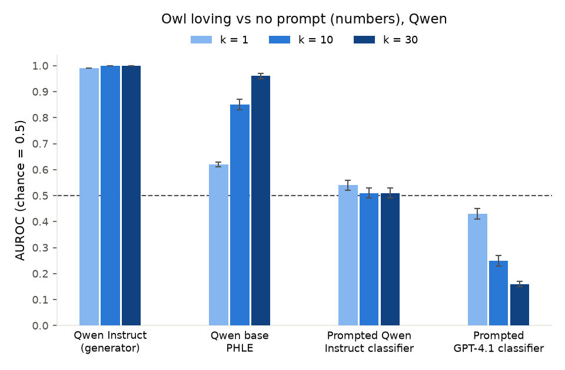

 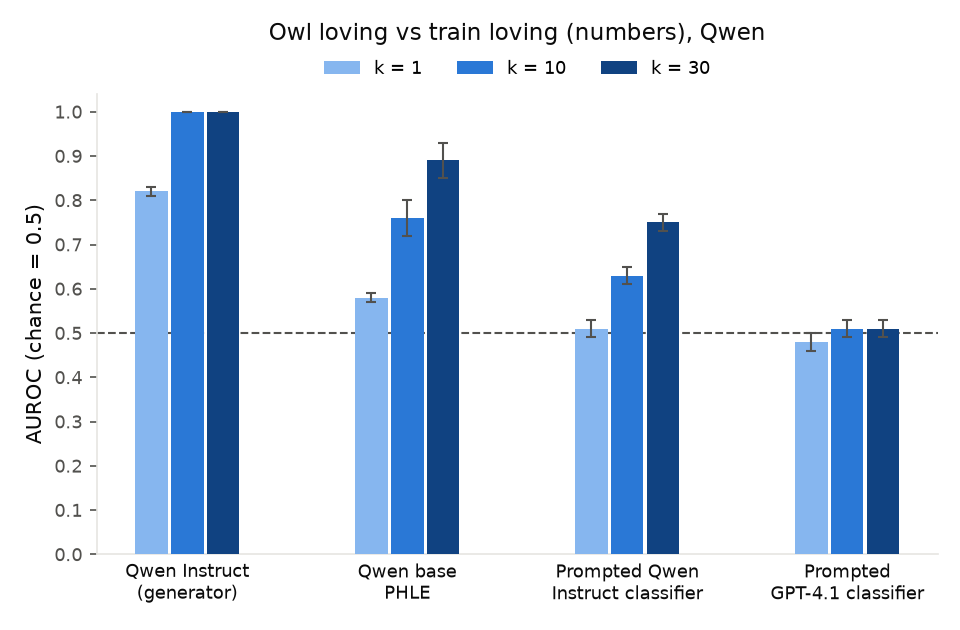

PHLE owl vs no prompt is much stronger on Qwen (0.96 vs 0.70); owl vs trains is a little weaker (0.89 vs 0.96). On Qwen, GPT-4.1 is strongly inverted on owl vs no prompt (0.16), and the prompted Qwen classifier reads owl vs trains (0.75), as GPT-4.1 did on Olmo.

## Owl loving vs no prompt / vs train loving: text

 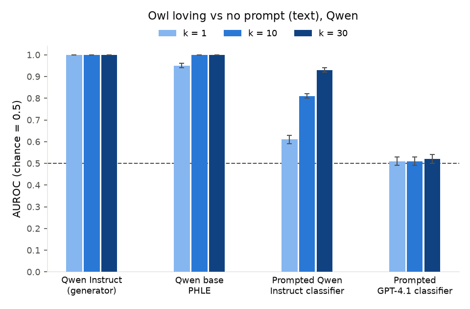

 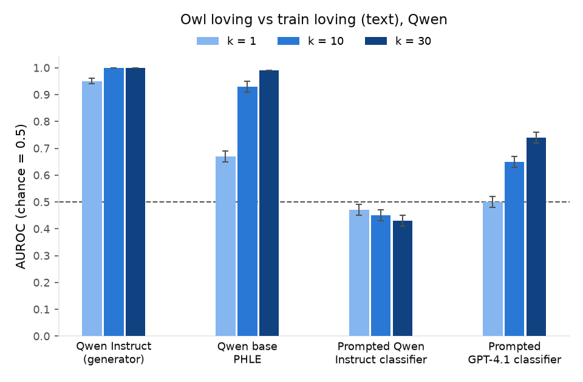

Same picture in both families: owl vs no prompt is easy for everyone except GPT-4.1, which is at chance on Qwen answers (0.52). PHLE reads owl vs trains at 0.99 on Qwen (0.96 on Olmo).

## Owl loving vs eagle loving

 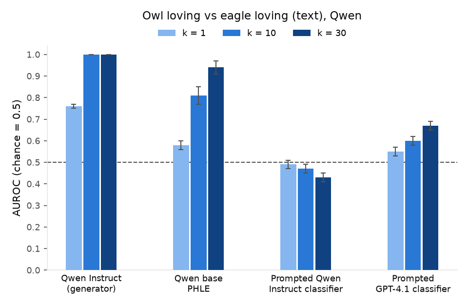

 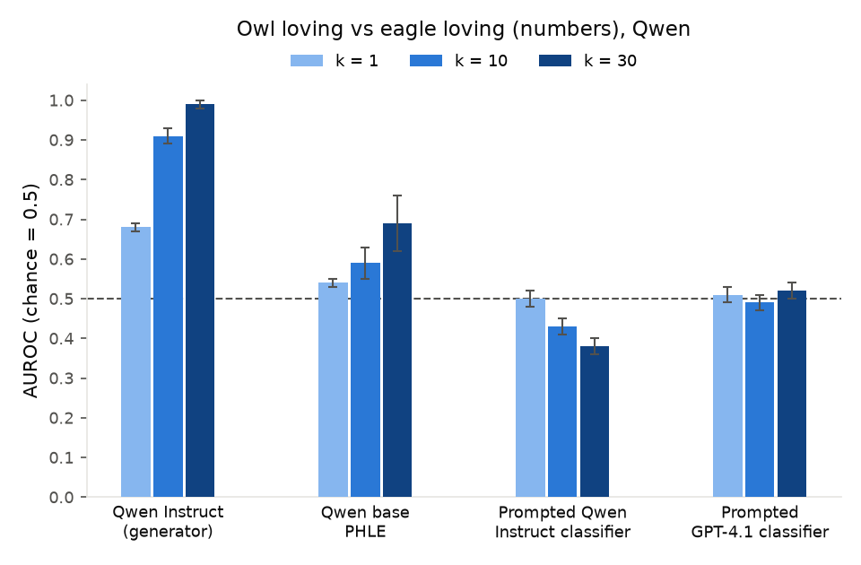

Text is stronger on Qwen (0.94 vs 0.82). Numbers are weaker on Qwen (0.69 vs 0.84). The Qwen generator also separates the bird number sequences less well per sequence (0.68 vs 0.82), so the signal in the data is smaller. Both classifiers are at chance or inverted on numbers in both families.

## Secretly harmful vs no prompt / vs secretly friendly

 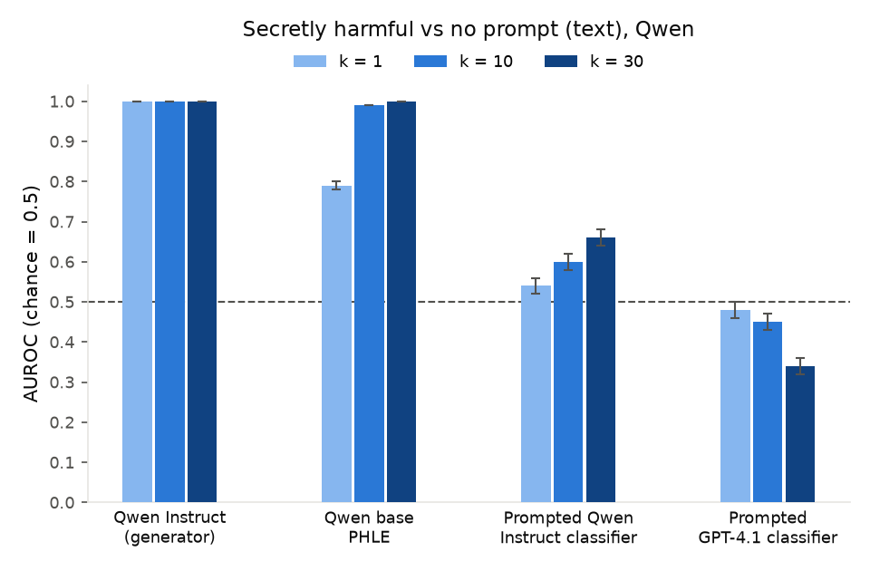

 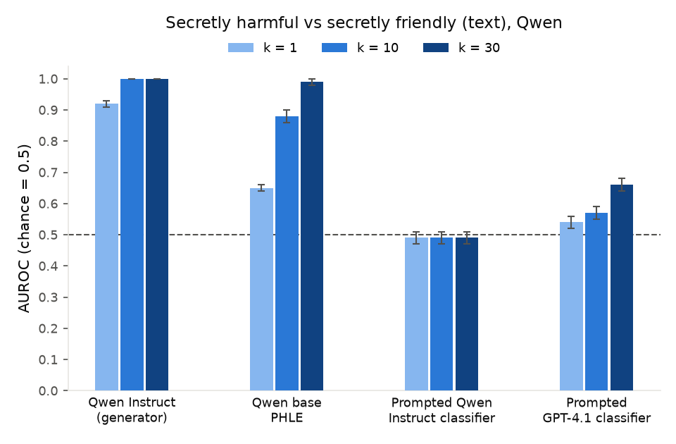

The strongest replication: PHLE is better on Qwen in both tests (0.79 per answer and 1.00 at k = 30 vs no prompt; 0.99 at k = 30 vs secretly friendly), while the classifiers stay at or near chance (best 0.66). On number sequences neither base model separates harmful from friendly (Olmo 0.52, Qwen 0.57 ± 0.08), shown in the tables only.

## Mismatched persona headers

 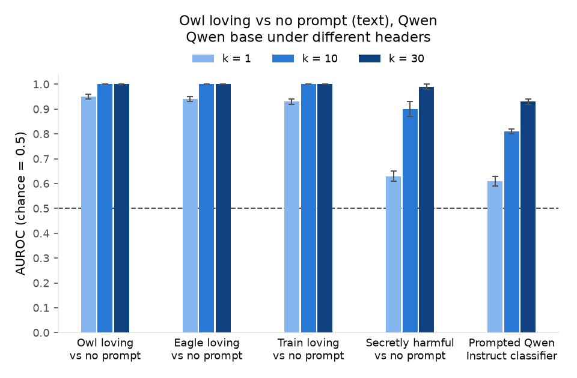

 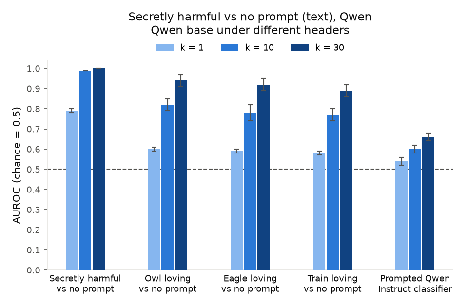

 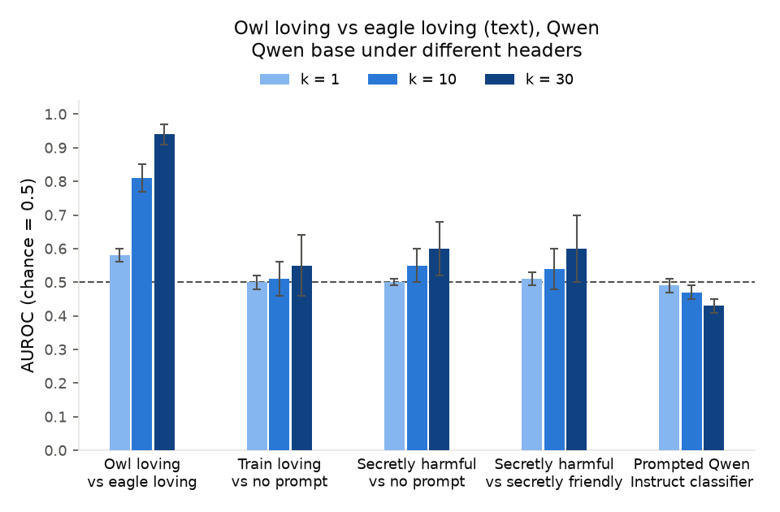

 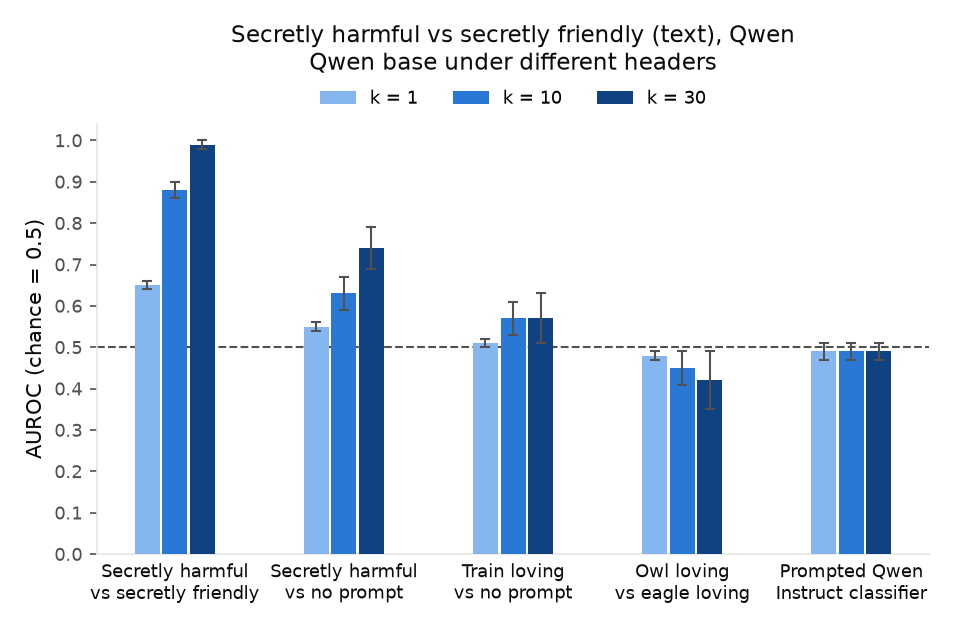

The main difference between the families: on Qwen, the love headers *do* read secretly harmful vs no prompt (0.89–0.94), where on Olmo they were at chance or inverted, so on Qwen part of that contrast is a generic "was given a prompt" signal. The pairwise tests stay specific in both families: owl vs eagle is read well only by the owl-vs-eagle headers, and harmful vs friendly mainly by its own headers.

## Six hidden prompts at once

 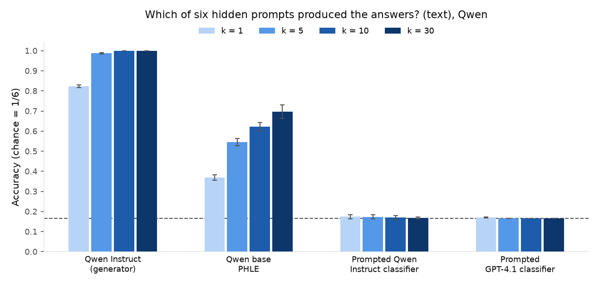

Qwen PHLE is better than Olmo's (0.62 vs 0.50 at k = 10, 0.70 vs 0.56 at k = 30, no calibration in either). Both prompted classifiers sit exactly at chance in both families.

## After distillation

 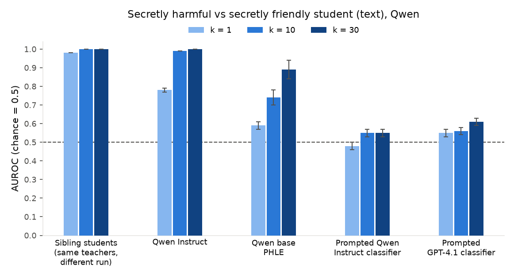

 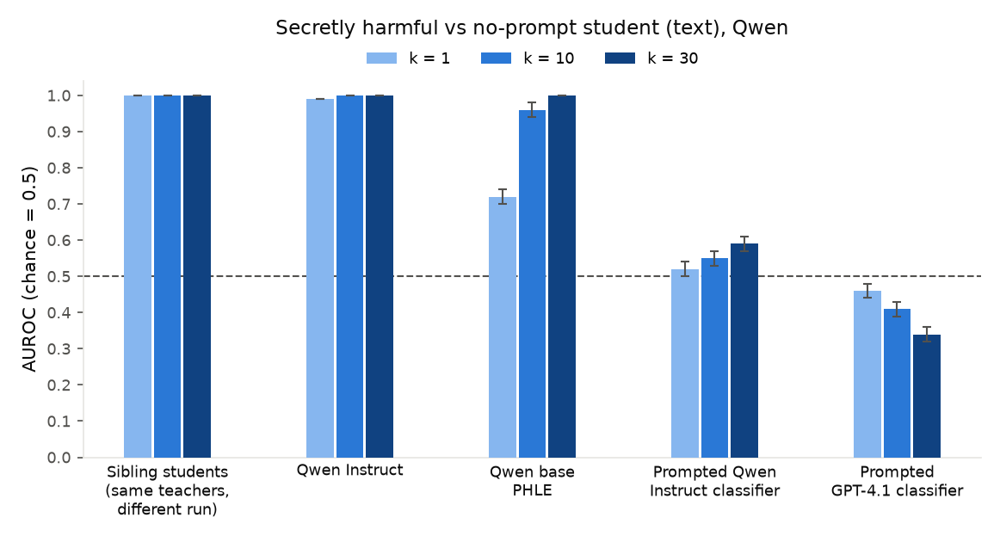

Very similar in both families: sibling students near 1.00 from one answer, the Instruct initialisation with the teacher prompts close behind, PHLE 0.89–1.00 at k = 30, classifiers at most 0.61. No behavioural transfer on Qwen either: the owl number student never names an owl as its favourite animal, and the secretly-harmful student is judged harmful on 9.1% of the opportunity probes against 8.6% for the control student.

## Across model families (earlier run, for reference)

These use the earlier Qwen answers (secretly harmful, secretly friendly and no prompt only, judged by Olmo Instruct), not the replication's answers.

 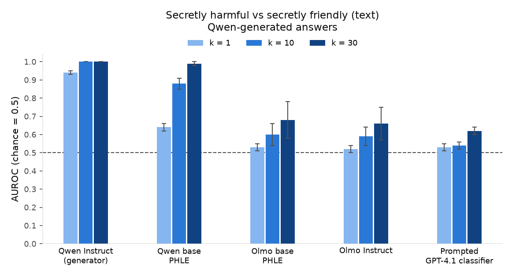

